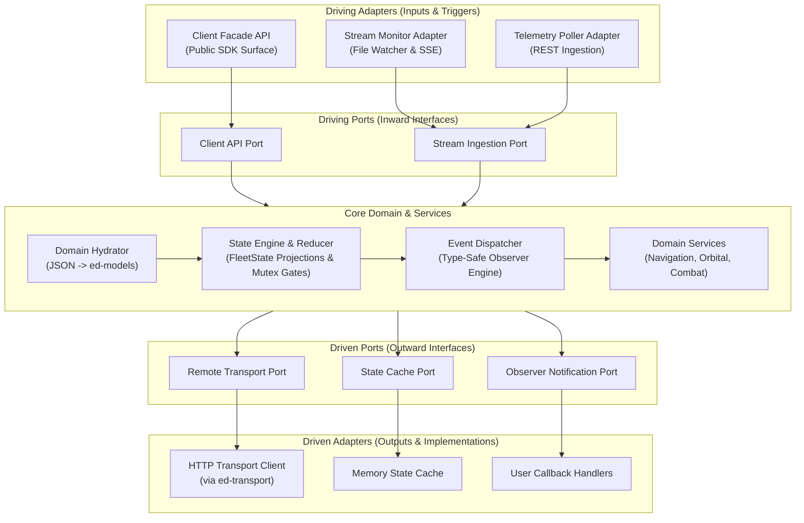

# ADR 0001: High-Level Hexagonal Architecture & Subsystem Integration

## 1. Context and Problem Statement

Downstream application developers building tools for *Elite Dangerous* (such as cockpit overlays, voice assistants, trade assistants, and web dashboards) need a clean, cohesive Software Development Kit (SDK).

During integration prototyping across the software fleet, six distinct functional modules were developed:
1. `ed_dispatcher`: Type-safe observer and event dispatch engine.
2. `ed_reducer`: Pure functional state reducer engine projecting unified fleet state.
3. `ed_telemetry_client`: Low-level HTTP transport client connecting to telemetry REST APIs.
4. `ed_stream_monitor`: Server-Sent Events (SSE) stream listener and journal file watcher.
5. `ed_hydrator`: Raw JSON to typed `ed-models` domain entity hydrator.
6. `ed_services`: Specialized domain calculation engines (orbital mechanics, navigation, combat analytics).

An architectural decision is required: Should these six modules be maintained as six separate, independent Git repositories, or should they be unified into a single, cohesive, hexagonally architected package within `ed-fleet-client`?

---

## 2. Decision Drivers

* **Consumer Ergonomics:** Provide a single, unified entry point (`pip install ed-fleet-client`) where third-party developers can immediately access event handling, state projection, and domain calculations without managing multiple packages.
* **Separation of Concerns:** Strictly separate core domain logic (state reduction, event routing, domain math) from outside technical adapters (HTTP clients, file watchers, transport sockets).
* **Operational Overhead:** Eliminate the maintenance friction of synchronizing seven independent Git repositories, CI/CD pipelines, and version releases for tightly coupled domain logic.
* **Architectural Testability:** Allow the entire client SDK to be tested with test doubles and in-memory mocks without requiring live network daemons or real journal files.

---

## 3. Decision Outcome

Chosen Option: **Integrated Hexagonal Architecture (Modular Monolith) within `ed-fleet-client`**.

The repository is organized following Ports and Adapters (Hexagonal Architecture) initialized via `python-hexagonal-template`, cleanly absorbing the six subsystem capabilities into explicit architectural layers.

---

## 4. Subsystem Mapping to Hexagonal Taxonomy

The functionality of the six prototype packages is assigned to specific directory namespaces within `src/ed_fleet_client/`:

| Prototype Subsystem | Hexagonal Layer | Destination Namespace | Responsibility |
| :--- | :--- | :--- | :--- |
| **`ed_reducer`** | Core Domain | `core/domain/state/` | Pure functional state machine, `FleetState` projections, and invariant mutual exclusion gates. |
| **`ed_dispatcher`** | Core Domain | `core/domain/dispatcher/` | Type-safe publish-subscribe event routing and observer registry. |
| **`ed_services`** | Core Domain | `core/domain/services/` | Domain math: orbital mechanics, jump route tracking, and combat analytics. |
| **`ed_hydrator`** | Driving Adapter | `adapters/driving/hydrator/` | Deserializes raw telemetry payloads into strongly typed `ed-models` entities. |
| **`ed_stream_monitor`**| Driving Adapter | `adapters/driving/stream/` | Watches journal log directories and streams real-time Server-Sent Events. |
| **`ed_telemetry_client`**| Driven Adapter | `adapters/driven/telemetry_http/`| Low-level HTTP transport client implementing outward `TransportPort`. |
| **`ed_fleet_client`** | Bootstrap / Facade| `client.py` & `bootstrap/` | High-level unified facade wiring ports to adapters and providing public API. |

---

## 5. Consequences & Trade-offs

### Positive
* **Unified Developer Experience:** Developers install one library (`ed-fleet-client`) and instantiate a single `EliteDangerousClient` instance to handle all telemetry operations.
* **Atomic Versioning:** Changes to game models or state logic update atomically across the SDK without cross-repository release delays.
* **Architectural Decoupling:** Core state and calculation logic has zero dependencies on network sockets, allowing 100% offline unit testing.

### Negative
* **Monolithic Packaging:** Users who only desire an in-memory event bus or an HTTP client must install the full `ed-fleet-client` package.
* **Discipline Enforcement:** Strict package import linters (ImportLinter) must be configured in CI to prevent core domain logic from inadvertently importing outward adapters.
