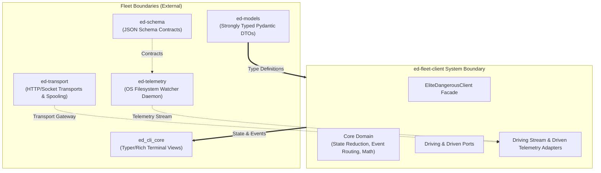
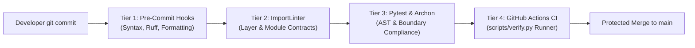

# ADR 0002: System Scope, Architectural Boundaries, and Multi-Tier Automated Enforcement

## 1. Context and Problem Statement

Based on the Use-Case specifications ([UC-01 to UC-04](file:///home/michael/src/github.com/mnaatjes/ed-fleet-client/architecture/use-cases/)) and Master Risk Register ([RISK-01 to RISK-06](file:///home/michael/src/github.com/mnaatjes/ed-fleet-client/architecture/risk/risk-list.md)), `ed-fleet-client` serves as the high-level, client-facing SDK and state management facade for the *Elite Dangerous* software fleet.

Without formally defined system scope and automated architectural boundary gates:
1. **Scope Creep (RISK-02, RISK-03):** Lower-level responsibilities (such as raw JSON Schema validation, raw socket manipulation, or UI widget rendering) bleed into `ed-fleet-client`, duplicating work owned by `ed-schema`, `ed-transport`, or `ed_cli_core`.
2. **Hexagonal Boundary Erosion (RISK-05):** Inner business logic in `core/domain` (state reduction, event routing, domain math) could inadvertently import outward technical adapters (`adapters/driving/stream`, `adapters/driven/telemetry_http`), creating circular loops and destroying testability.
3. **Desynchronized Ingestion (RISK-01):** Telemetry state projection could ingest corrupted status bitmasks if physical mutual exclusion validation is bypassed.

This ADR defines the authoritative system scope (In-Scope vs. Out-of-Scope) and establishes a multi-tiered, automated enforcement architecture using pre-commit hooks, ImportLinter contracts, Pytest boundary tests, and CI pipelines.

---

## 2. Decision Drivers

* **Acyclic Dependencies Principle (ADP):** Core domain logic must never import from outward adapters, external web frameworks, or transport libraries.
* **Hermetic Testability:** The entire SDK core (state engine, event dispatcher, domain services) must remain 100% testable in-memory without requiring live network sockets, daemons, or disk files.
* **Deterministic Automated Gating:** Architectural boundaries must be verified mechanically on every developer commit and pull request rather than through human code review alone.
* **Separation of Fleet Responsibilities:** Clear division of labor across fleet libraries (`ed-schema`, `ed-models`, `ed-transport`, `ed-telemetry`, `ed-fleet-client`).

---

## 3. Decision Outcome

Chosen Option: **Explicit Scope Partitioning with 4-Tier Automated Boundary Enforcement**.

---

## 4. System Scope & Division of Labor



### 4.1 In-Scope for `ed-fleet-client`
* **Unified Client Facade:** Providing the single developer-facing `EliteDangerousClient` instance.
* **State Engine & Reduction (UC-01):** Pure-functional folding of status bitmasks and journal logs into `FleetState`, including the **Mutex Invariant Validation Gate** to prevent corrupted state projections.
* **Type-Safe Event Dispatching (UC-02):** In-memory observer registration (`on_event`) and composite lifecycle subscriptions (`hyperspace_transit`, `station_docking`).
* **Snapshot Extended Hydration (UC-03):** Reading in-place companion snapshot files (`Market.json`, `Cargo.json`, `Shipyard.json`) and hydrating extended DTOs, including Fleet Carrier duality handling (RES-0001).
* **Domain Calculation Services (UC-04):** Orbital velocity math, jump route tracking, and journey ETA estimation.

### 4.2 Out-of-Scope (Delegated to Fleet Libraries)
* **Raw Schema Validation:** JSON Schema Draft-07/2020-12 indexing and payload pre-flight validation are owned strictly by `ed-schema`.
* **Low-Level Socket / HTTP Spooling:** Retries, offline request queuing, and gateway connections are owned strictly by `ed-transport`.
* **Operating System File Probing:** Cross-platform path discovery (`Saved Games` folder lookup on Linux/Proton/Windows) is owned strictly by `ed-telemetry`.
* **Terminal UI / Visual Widgets:** Typer CLI commands, Rich tables, and Textual dashboards are owned strictly by `ed_cli_core`.
* **Third-Party Egress Transmissions:** Uploading commodity prices to EDDN or syncing profiles with Inara is owned by upstream integration daemons.

---

## 5. Multi-Tier Automated Boundary Enforcement Architecture

To guarantee that code authored in `ed-fleet-client` adheres strictly to these boundaries, four automated verification gates are enforced:



### Tier 1: Local Pre-Commit Hooks (`.pre-commit-config.yaml`)
* **Execution:** Runs automatically before `git commit` via pre-commit framework.
* **Checks:**
  - Trailing whitespace removal and EOF fixing.
  - YAML and TOML syntax verification.
  - Ruff linting (`ruff check --fix`) and code formatting (`ruff format`).

### Tier 2: ImportLinter Layer Contracts (`.importlinter`)
* **Execution:** Runs via `lint-imports` in local verification scripts and CI.
* **Contracts Enforced:**
  1. `core_domain_isolation`: `ed_fleet_client.core.domain` is strictly forbidden from importing `ed_fleet_client.adapters` or external frameworks.
  2. `inward_dependency_direction`: Enforces strict layering order: `adapters` $\to$ `core.use_cases` $\to$ `core.domain`.
  3. `domain_port_isolation`: `core.domain` never imports `core.ports` or `core.use_cases`.
  4. `use_case_transport_isolation`: `core.use_cases` is forbidden from importing `adapters` or transport web frameworks (`fastapi`, `starlette`, `flask`, `click`, `typer`).
  5. `composition_root_isolation`: No internal layer is permitted to import `ed_fleet_client.bootstrap`.

### Tier 3: Pytest Architectural Boundary Suite (`tests/architecture/test_boundaries.py`)
* **Execution:** Runs via `pytest tests/architecture/` with `pytest-archon`.
* **Automated AST Invariants:**
  - `test_core_domain_has_zero_external_dependencies()`: Walks the AST of every Python file in `core/domain` and fails if any outer adapter or non-standard dependency is referenced.
  - `test_dependencies_point_strictly_inward()`: Verifies that core modules never point outward.
  - `test_ports_are_abstract_protocols_or_abcs()`: Confirms all ports in `core/ports` declare abstract methods or protocols with zero concrete implementation leaks.

### Tier 4: Continuous Integration Pipeline (`.github/workflows/ci.yml`)
* **Execution:** Runs on every push and pull request targeting `main`.
* **Runner Script (`scripts/verify.py`):** Deterministically executes the full verification sequence in order:
  ```bash
  1. pre-commit run --all-files
  2. lint-imports
  3. mypy src/
  4. pytest tests/
  ```
* **Gate Policy:** Any architectural regression, illegal import, or broken boundary test immediately fails the build, blocking merge to `main`.

---

## 6. Consequences & Traceability

* **Traceability:**
  - Mitigates **RISK-01** (via in-scope Mutex Invariant Gate in state engine).
  - Mitigates **RISK-02** (via strict decoupling of telemetry driven port from concrete HTTP adapters).
  - Mitigates **RISK-05** (via Tier 2 ImportLinter and Tier 3 Pytest boundary tests).
  - Implements requirements from **UC-01**, **UC-02**, **UC-03**, and **UC-04**.
* **Operational Guarantee:** Developers cannot violate the Hexagonal Architecture without failing automated checks locally and in CI.
