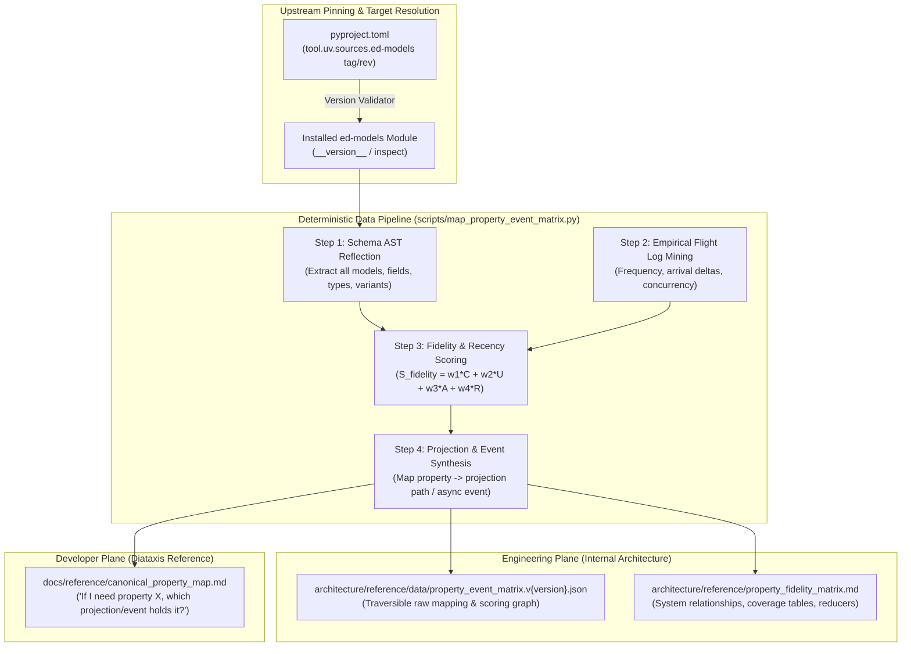

# ADR 0005: Deterministic Telemetry Property-to-Event Derivation & Fidelity Mapping Pipeline

## 1. Context and Problem Statement

In the Frontier Developments *Elite Dangerous* telemetry architecture, player and vessel state is distributed across ~285 journal event schemas and continuous `Status.json` polling. Consequently:
1. **Property Concurrency:** Multiple distinct events emit identical underlying properties (e.g. current star system is emitted by `FSDJump`, `Location`, `CarrierJump`, `NavRoute`, and `Status.json`).
2. **Varying Recency & Frequency:** High-frequency events (like 1–4 Hz `Status.json`) report transient cockpit values (fuel, pips, flight flags), while low-frequency lifecycle events (`Loadout`, `LoadGame`) report authoritative structural snapshots.
3. **Property Fidelity Discrepancies:** Certain events report truncated or raw localized strings, while others emit authoritative IDs and 64-bit Frontier hashes (e.g., `StarSystem` string name vs. `SystemAddress` int64).
4. **Coupling to Upstream Model Evolution:** As Frontier updates the game, new events and properties are added upstream in `ed-models`. Without a version-pinned, repeatable extraction pipeline, our architecture and documentation become desynchronized from the actual model definitions.
5. **Developer Cognitive Burden:** Without an authoritative canonical property-to-event reference, developers and component authors must guess which event to subscribe to or which projection holds a given value, risking stale state projections or redundant event listening.

To eliminate guesswork and establish a single source of truth for reducer implementations, architectural verification, and developer documentation, we require a **repeatable, deterministic data pipeline**.

---

## 2. Decision Drivers

* **Determinism & Repeatability:** Mapping must be generated via code inspection and historical telemetry mining, not manual documentation writing.
* **Dual-Plane Artifact Delivery:** Produce both machine-readable JSON (for algorithmic traversal and validation) and human-readable Markdown (for architectural governance and Diataxis reference).
* **Strict Version Binding:** The pipeline MUST bind to the exact version of `ed-models` pinned in `ed-fleet-client/pyproject.toml`.
* **Automated Data Pipeline Lifecycle:** The pipeline must be repeatable and executable on every `ed-models` upgrade, acting as a prerequisite before deriving facade convenience methods.
* **Separation of Concerns:** Clear demarcation between Engineering Plane artifacts (`architecture/reference/`) and Customer/Developer Plane documentation (`docs/reference/`).

---

## 3. Decision Outcome

We establish a repeatable data pipeline implemented as an executable script in `ed-fleet-client` (`scripts/map_property_event_matrix.py`). The pipeline deterministically extracts, analyzes, and synthesizes the **6 Canonical Mapping Dimensions** from the version-pinned `ed-models` dependency and outputs version-tagged JSON and Markdown artifacts across both the Engineering Plane and Developer Documentation Plane.



---

## 4. The 6 Canonical Mapping Dimensions

### 4.1 Dimension 1: Property Sources
* **Objective:** Identify every event schema that exposes a specific field name or semantic property.
* **Acquisition (AST Reflection):** Inspects dataclass/Pydantic fields across all journal events and `StatusTelemetry` in `ed-models`. Normalizes field naming variants (e.g. `SystemName`, `StarSystem`, and `Destination.Name` map to canonical property `star_system`).

### 4.2 Dimension 2: Property Importance
* **Objective:** Rank raw fields into high-value domain properties for UI and gameplay consumers.
* **Acquisition (Tiered Domain Classification):**
  * **Tier 1 (Core Navigation & State):** Spatial coordinates, current system, vessel model, commander name, alive/docked status.
  * **Tier 2 (Operational Telemetry):** Fuel levels, pips, cargo capacity, hull/shield percentages, heading, altitude.
  * **Tier 3 (Contextual & Market):** Station services, market IDs, faction allegiances, system economies.
  * **Tier 4 (Ephemeral / Granular):** Audio triggers, NPC banter text pass-throughs, minor status flags.

### 4.3 Dimension 3: Event Frequency & Resolution
* **Objective:** Quantify how frequently each event triggers and updates properties.
* **Acquisition (Corpus Mining):** Ingests reference gameplay logs and computes:
  * Mean trigger rate per flight hour ($\lambda_{\text{event}}$).
  * Inter-arrival distribution ($\Delta t$ percentiles).
  * Cadence category: Continuous Polled (1–4 Hz), Regime Phase Transitions (~2–10 min), or Rare Lifecycle (docking, ship purchase).

### 4.4 Dimension 4: Property Freshness
* **Objective:** Identify which source reflects game state changes with lowest latency.
* **Acquisition (State Transition Delta Analysis):** Measures latency $\Delta t_{\text{latency}} = t_{\text{event}} - t_{\text{physical\_change}}$. Determines whether `Status.json` (immediate cockpit poll) or a specific journal event (`FSDJump` vs. `StartJump`) provides the freshest value for each phase of flight.

### 4.5 Dimension 5: Event Concurrency & Overlap
* **Objective:** Map overlapping property surfaces and evaluate divergence.
* **Acquisition (Intersection Matrix):** For any property appearing in multiple events, evaluates semantic consistency and identifies temporal lag where one event remains temporarily stale while another updates.

### 4.6 Dimension 6: Property Fidelity & Authority
* **Objective:** Calculate an authoritative Fidelity Score ($S_{\text{fidelity}}$) to designate the primary source.
* **Scoring Formula:**
  $$S_{\text{fidelity}} = w_1 \cdot C_{\text{completeness}} + w_2 \cdot U_{\text{uniqueness}} + w_3 \cdot A_{\text{accuracy}} + w_4 \cdot R_{\text{recency}}$$
  Where:
  * $C_{\text{completeness}}$: Presence of companion metadata (e.g. `FSDJump` includes coordinates, population, economy; `Location` includes station details).
  * $U_{\text{uniqueness}}$: Presence of 64-bit numerical identifiers (`SystemAddress`, `MarketID`) vs. non-unique localized string names.
  * $A_{\text{accuracy}}$: Resistance to stale values during multi-step transitions.
  * $R_{\text{recency}}$: Frequency of updates during active gameplay.

---

## 5. Model Version Targeting & Version Pinning Contract

To guarantee deterministic repeatability and prevent drift:
1. **Target Version Resolution:**
   The pipeline runner reads the target version from `ed-fleet-client/pyproject.toml`:
   * Inspects `[tool.uv.sources.ed-models]` for explicit `tag`, `rev`, or version constraints.
   * Compares against the installed runtime package `ed_models.__version__`.
   * **Invariant Gate:** If the installed `ed-models` version does not match the pinned `pyproject.toml` definition, the pipeline halts with an error.
2. **Metadata Embedding:**
   Every generated output (JSON and Markdown) embeds frontmatter/header metadata declaring:
   ```yaml
   ed_models_version: "v0.2.1"
   generator: "scripts/map_property_event_matrix.py"
   generated_at: "YYYY-MM-DDTHH:MM:SSZ"
   schema_hash: "sha256-..."
   ```
3. **Upgrade Trigger Invariant:**
   Whenever `pyproject.toml` is updated with a newer `ed-models` tag:
   1. `uv sync` installs the new models.
   2. The pipeline script is executed to regenerate mapping artifacts.
   3. Architectural changes and new facade conveniences are reviewed against the updated diff.

---

## 6. Generated Pipeline Artifacts

The pipeline generates three distinct, complementary artifacts:

### 6.1 Traversible JSON Graph (`architecture/reference/data/property_event_matrix.json`)
A machine-readable, fully structured JSON dataset containing:
* Inverted property index with type annotations, parent classes, and schema field names.
* Frequency, freshness, and fidelity scores for every (property, event) pair.
* Recommended primary, fallback, and live-streaming sources.
* Designed for programmatic traversal by automated tests, code generators, and IDE linters.

### 6.2 Architectural Relationship Tables (`architecture/reference/property_fidelity_matrix.md`)
An engineering-plane document featuring Markdown tables that map:
* Architectural relationships between domain entities, reducers, and event types.
* Reducer coverage: Validates that every Tier 1 and Tier 2 property is properly ingested by `core/domain/state/reducers.py`.
* Concurrency conflict resolution rules implemented in the state engine.

### 6.3 End-User Diataxis Reference Guide (`docs/reference/canonical_property_map.md`)
A user-facing Diataxis Reference document organized to directly answer:
> *"If I need property X, which projection or async-event holds it, and which journal/status events contribute to it?"*

Structured as a lookup manual:
| Canonical Property | Client Accessor | Event / Stream Type | Authoritative Source | Low-Latency Indicator | Notes / Caveats |
| :--- | :--- | :--- | :--- | :--- | :--- |
| **Current Star System** | `client.location.star_system` | `client.on(FSDJump)` | `FSDJump` (arrival) | `Status.json` (destination) | Populated on boot via `Location`; updated via `CarrierJump` |
| **Vessel Ship Type** | `client.ship.ship_type` | `client.on(Loadout)` | `Loadout` | `ShipyardSwap` / `Buy` | Basic type in `LoadGame`; full specs in `Loadout` |
| **Fuel Remaining** | `client.ship.telemetry.fuel_main` | `client.on(StatusTelemetry)` | `Status.json` (1 Hz) | `Status.json` | Snapshot in `FSDJump` is point-in-time only |
| **Target Lock** | `client.navigation.destination_name` | `client.on(FSDTarget)` | `FSDTarget` | `Status.Destination` | Cleared upon jump execution |

---

## 7. Pipeline Execution Architecture

The pipeline is authored under `ed-fleet-client/scripts/` and invoked as:

```bash
# Execute deterministic extraction using pinned pyproject.toml ed-models version
.venv/bin/python scripts/map_property_event_matrix.py \
    --verify-version \
    --corpus-dir ./data/reference_logs/ \
    --out-json architecture/reference/data/property_event_matrix.json \
    --out-arch architecture/reference/property_fidelity_matrix.md \
    --out-docs docs/reference/canonical_property_map.md
```

### Automation & CI Integration
* Added to `scripts/verify.py` and GitHub Actions CI:
  * A sanity check runs `--verify-version --dry-run` to assert that documentation and matrix artifacts are synchronized with the pinned `ed-models` version on every pull request.

---

## 8. Consequences

### Positive
* **Zero Speculation:** State engine reducers and facade convenience methods are backed by mathematically grounded fidelity scores.
* **Living Documentation:** User documentation in `docs/` is automatically kept in lockstep with upstream `ed-models` releases.
* **Repeatable Evolution:** When Frontier updates Elite Dangerous and `ed-models` releases a new version, regenerating full fleet mappings requires running a single script.
* **Facade Blueprint:** Provides an exact specification for which convenience getters (e.g. `client.current_system`, `client.current_ship`, `client.last_jump`) belong on the client facade.

### Negative / Trade-offs
* **Corpus Requirement:** Empirical frequency and latency metrics require maintaining a representative reference flight log corpus in `data/reference_logs/`.

---

## 9. Addendum 1: Dataclass Schema Reflection for Projection Targets (2026-11-23)

### Context & Decision
In the initial v0.2.1 implementation of the pipeline, projection attribute mappings were defined via a static dictionary (`PROJECTION_TARGET_MAP`) in `scripts/pipeline/artifact_synthesizer.py`. This presented a risk of configuration drift whenever new state projections or reducers were added to `core/domain/state/models.py`.

To eliminate manual ledger maintenance and preserve the single-source-of-truth principle:
1. **Dynamic Dataclass Introspection:** `scripts/pipeline/schema_inspector.py` dynamically introspects `ClientStateProjection` and its nested projection classes (`LocationProjection`, `SessionProjection`, `ShipProjection`) using `dataclasses.fields()`.
2. **Deterministic Dot-Notation Derivation:** The pipeline automatically builds dot-notation target paths (e.g. `location.star_system`, `session.commander_name`, `ship.cargo_capacity`) from domain models at pipeline execution time.
3. **Automated Architectural Gate:** Architecture tests (`tests/architecture/test_property_event_matrix.py`) assert that all domain projection fields are properly resolved without requiring duplicate YAML or dictionary registries.
