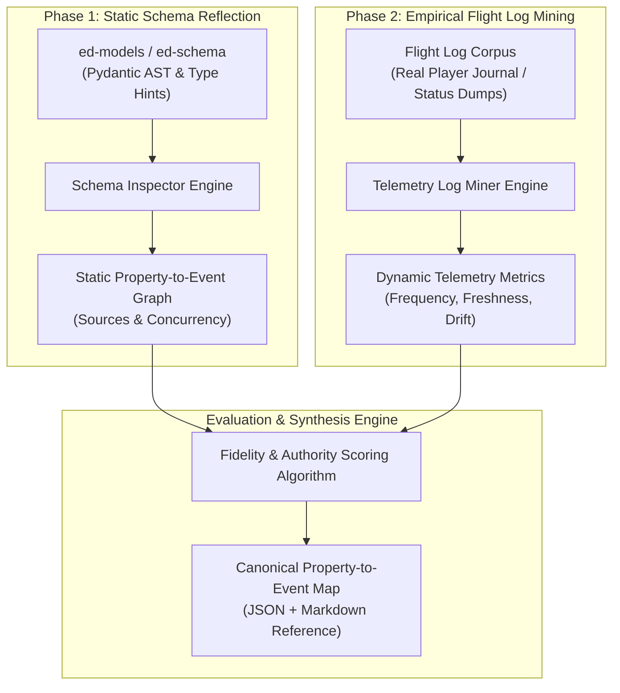

# ADR 0005: Deterministic Telemetry Property-to-Event Derivation & Fidelity Mapping Pipeline

## 1. Context and Problem Statement

In the Frontier Developments *Elite Dangerous* telemetry architecture, game state is distributed across ~285 journal event schemas and continuous `Status.json` cockpit polling. Consequently:
1. **Concurrency of Properties:** Multiple distinct events report identical underlying game properties (e.g., current star system is emitted by `FSDJump`, `Location`, `CarrierJump`, `NavRoute`, and `Status.json`).
2. **Varying Recency & Frequency:** High-frequency events (like 1–4 Hz `Status.json`) report transient cockpit values (fuel, pips, flight flags), while low-frequency lifecycle events (`Loadout`, `LoadGame`) report authoritative structural snapshots.
3. **Property Fidelity Discrepancies:** Certain events report truncated or raw localized strings, while others emit authoritative IDs and 64-bit Frontier hashes (e.g., `StarSystem` name vs. `SystemAddress` int64).
4. **Developer Cognitive Burden:** Without an authoritative canonical property-to-event reference, developers and component authors must guess which event to subscribe to, risking stale state projections or redundant event listening.

To eliminate guesswork and establish a single source of truth for both reducer implementations and developer documentation, we require a **deterministic analysis pipeline** that mechanically maps and evaluates all property-event relationships.

---

## 2. Decision Drivers

* **Determinism & Reproducibility:** Mapping must be generated via code inspection and historical telemetry mining, not human guesswork.
* **Separation of Static Schema vs. Empirical Runtime:** Static typing defines *where* properties exist; empirical flight log mining defines *how often* and *when* they change.
* **Objective Fidelity Scoring:** Formulate explicit criteria for determining which event source is authoritative for any given property.
* **Artifact Generation for Documentation:** Output machine-readable JSON and human-readable Markdown matrices for living documentation.

---

## 3. Decision Outcome

We adopt a two-phase deterministic pipeline consisting of **Static Schema Reflection** and **Empirical Flight Log Telemetry Mining** to compute the **6 Canonical Mapping Dimensions**.



---

## 4. The 6 Canonical Mapping Dimensions & Deterministic Acquisition

### 4.1 Dimension 1: Property Sources (Which events hold which properties)
* **Objective:** Identify every event schema that exposes a specific field name or semantic property.
* **Acquisition Method (Static AST Reflection):**
  A script inspects the dataclass/Pydantic field definitions across `ed_models.core.domain.events.*` and `StatusTelemetry`. It constructs an inverted index:
  $$\text{Property} \to [\text{Event}_1, \text{Event}_2, \dots, \text{Event}_k]$$
* **Standardization:** Normalizes snake_case, PascalCase, and `_Localised` property variants into canonical property keys (e.g. `SystemName`, `StarSystem`, and `Destination.Name` normalize to `canonical_property: "star_system"`).

### 4.2 Dimension 2: Property Importance (Which properties to track)
* **Objective:** Filter and rank the ~1,200 raw schema fields into high-value domain properties.
* **Acquisition Method (Tiered Domain Classification):**
  Properties are classified into deterministic tiers:
  * **Tier 1 (Core Navigation & State):** Required for spatial location, active vessel, commander identity, and session safety.
  * **Tier 2 (Operational Telemetry):** Real-time flight dynamics (fuel, throttle, pips, cargo count, hull/shield percentage).
  * **Tier 3 (Contextual & Station):** Station services, market IDs, faction allegiances, system economies.
  * **Tier 4 (Ephemeral / Granular):** Raw audio cues, minor UI text pass-throughs, internal debug flags.
  Importance weighting ($W_{\text{importance}}$) is assigned deterministically based on tier assignment.

### 4.3 Dimension 3: Event Frequency & Resolution (Trigger cadence)
* **Objective:** Determine how often each event fires and how quickly it updates property values.
* **Acquisition Method (Corpus Mining):**
  The script ingests a standard reference corpus of flight logs (e.g., 50+ hours of mixed gameplay: exploration, combat, trading, supercruise) and calculates:
  * Mean events per hour ($\lambda_{\text{event}}$).
  * Minimum, median, and 99th-percentile inter-arrival time ($\Delta t$).
  * Distinct categorization: Polled Continuous (1–4 Hz), Phase Transitions (Supercruise/Hyperspace ~2–10 mins), or Rare Lifecycle (Docking, Ship Purchase, Death).

### 4.4 Dimension 4: Property Freshness (Where to get the freshest value)
* **Objective:** Determine which source reflects physical game reality with the lowest latency.
* **Acquisition Method (State Transition Timestamp Analysis):**
  When an in-game state transition occurs, the miner records the time delta between event generation:
  $$\Delta t_{\text{latency}} = t_{\text{event}} - t_{\text{physical\_change}}$$
  * *Example:* When jumping systems, `Status.json` updates flags first, `StartJump` announces hyperspace entry, and `FSDJump` writes upon tunnel completion. The pipeline classifies `Status.json` as the lowest-latency indicator for *jump intent* and `FSDJump` as the authoritative indicator for *arrival*.

### 4.5 Dimension 5: Event Concurrency & Overlap
* **Objective:** Map overlapping property surfaces and detect divergence.
* **Acquisition Method (Intersection Matrix):**
  The script generates an $N \times N$ matrix of concurrent events sharing properties. For all pairs $(E_a, E_b)$ sharing property $P$:
  * Calculates semantic agreement rate: $\text{Match}(E_a.P, E_b.P) / \text{Total Co-occurrences}$.
  * Flags temporal offsets where one event temporarily holds a stale value while another holds a refreshed value.

### 4.6 Dimension 6: Property Fidelity & Authority (Which event is most reliable)
* **Objective:** Calculate an authoritative Fidelity Score ($S_{\text{fidelity}}$) for each property source.
* **Scoring Formula:**
  $$S_{\text{fidelity}} = w_1 \cdot C_{\text{completeness}} + w_2 \cdot U_{\text{uniqueness}} + w_3 \cdot A_{\text{accuracy}} + w_4 \cdot R_{\text{recency}}$$
  Where:
  * $C_{\text{completeness}}$: Presence of companion metadata (e.g. `FSDJump` supplies `StarPos`, `SystemAddress`, and economy; `Location` supplies station details; `Status.json` supplies only name and system address).
  * $U_{\text{uniqueness}}$: Use of 64-bit numerical IDs (`SystemAddress`, `MarketID`) vs. non-unique or user-renamed strings.
  * $A_{\text{accuracy}}$: Resistance to stale values during multi-step transitions.
  * $R_{\text{recency}}$: Frequency of updates during active flight regimes.

---

## 5. Execution Pipeline & Generated Outputs

The pipeline is packaged as a reproducible tool in `ed-fleet-client` (`scripts/analyze_telemetry_fidelity.py`):

```bash
# Execute static schema reflection and log corpus evaluation
.venv/bin/python scripts/analyze_telemetry_fidelity.py \
    --corpus-dir ./data/reference_logs/ \
    --output-json docs/reference/property_event_matrix.json \
    --output-markdown docs/reference/canonical_property_map.md
```

### Generated Artifacts
1. **Machine-Readable Matrix (`property_event_matrix.json`):**
   Full structured JSON utilized by unit tests and code-generators to enforce reducer precedence rules.
2. **Canonical Developer Reference Guide (`canonical_property_map.md`):**
   Diataxis Reference manual detailing for each domain property:
   * Target projection attribute (`client.location.star_system`).
   * Authoritative source event (`FSDJump`).
   * Fallback/Initial source event (`Location`).
   * Low-latency indicator (`Status.json`).
   * Fidelity score and update resolution.

---

## 6. Consequences

### Positive
* **Elimination of Speculative Reducers:** Event reducers in `core/domain/state/reducers.py` will be governed by mathematical fidelity scores rather than ad-hoc heuristics.
* **Living Developer Documentation:** End users have an authoritative reference explaining exactly where and how to obtain any property in the Elite Dangerous universe.
* **Informed Facade Design:** The upcoming Convenience Facade will expose properties and aliases backed directly by the highest-fidelity sources identified by this pipeline.

### Negative / Trade-offs
* **Corpus Maintenance:** Requires maintaining a reference corpus of representative journal and status files covering varied gameplay regimes.
