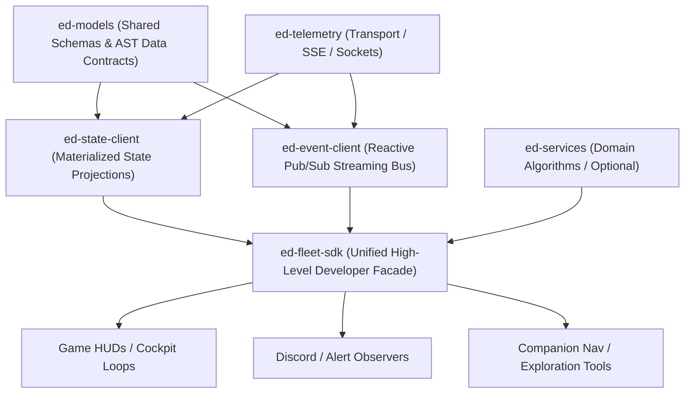

# Draft ADR: Decoupling Telemetry State Projections, Event Streaming Bus, and Facade SDK into Specialized Client Repositories

## 1. Context and Problem Statement

The current `ed-fleet-client` repository bundles three fundamentally distinct software engineering paradigms into a single unified library and facade object (`EliteDangerousClient`):
1. **Synchronous State Engine & Reducers:** Passive, deterministic, in-memory materialized projections (`client.location`, `client.ship`, `client.session`) designed for game loops and high-frequency UI sampling.
2. **Asynchronous Reactive Event Bus:** Active, non-blocking pub/sub observer mechanisms (`@client.on(EventType)`, `client.subscribe()`) designed for notifications, alerts, audio cues, and side-effect delegation.
3. **Domain Calculation Services & Facade Composition:** Stateless computational domain algorithms (`orbital`, `navigation`, `combat_analytics`, `flight_performance`, `astrophysics`) composed together with snapshot hydrators and stream transports.

While these subsystems all consume upstream *Elite Dangerous* telemetry (originating from `ed-telemetry` REST/SSE or WebSocket streams and typed via `ed-models`), their co-location within a single package introduces architectural and cognitive friction:
* **Conflation of Consumption Paradigms:** Developers struggle with competing mental models (push vs. pull). Subscribing to `@client.on(FSDJump)` feels redundant when `client.location.star_system` is also available, blurring the line between discrete past events and continuous ambient state.
* **Competing Operational Lifecycles:** An overlay HUD only needs instantaneous state sampling in RAM with zero overhead and does not need event queueing or listener callback loops. Conversely, a Discord bot or alert siren only needs discrete event triggers and does not require allocating memory for continuous 3D coordinate and orbital tracking projections.
* **God Facade Anti-Pattern:** `EliteDangerousClient` accumulates responsibility for connection management, state mutation, invariant gating, event subscription, and domain service dispatching, violating the Single Responsibility Principle at the public API boundary.

We require an architectural blueprint for cleanly decomposing this ecosystem into specialized, independently consumable repositories with unambiguous directory topologies, domain scopes, and conceptual invariants.

---

## 2. Proposed Multi-Repository Topology

The current monolithic client architecture will be decomposed into two focused domain packages and one high-level developer convenience facade package:



### Repository Matrix

| Repository Name | Primary Paradigm | Core Responsibility | Key Invariants |
| :--- | :--- | :--- | :--- |
| `ed-state-client` | **Pull / Synchronous Sampling** | Ingest stream $\to$ Invariant Gate $\to$ Pure State Reducers $\to$ In-Memory RAM Projections | Zero async user callbacks; read operations take nanoseconds; pure functional reducers. |
| `ed-event-client` | **Push / Reactive Dispatch** | Ingest stream $\to$ Filter/Validate $\to$ Asynchronous Pub/Sub Fanout | Zero state retention; fire-and-forget concurrency; slowest listener cannot delay stream. |
| `ed-fleet-sdk` *(or `ed-client-facade`)* | **Composition / Ergonomic UX** | Wires state, events, and domain services into a cohesive, namespaced developer control plane | Enforces The Ordering Law; namespaces sub-contexts (`client.state`, `client.events`). |

---

## 3. Detailed Repository Specifications

### A. Repository 1: `ed-state-client`

* **Repository Identity:** `github.com/mnaatjes/ed-state-client`
* **Target Audience:** Cockpit simulators, HUD overlays (Dear ImGui, Qt, Flutter), telemetry loggers, and immediate-mode render loops.
* **Scope & Boundaries:**
  * **Strictly In-Scope:** Wire transport ingestion; invariant flight regime gating (`validate_mutex_invariants()`); pure mathematical event reducers; typed dataclass state projections (`LocationProjection`, `ShipProjection`, `SessionProjection`).
  * **Strictly Out-of-Scope:** Event bus subscription, user callbacks (`@client.on`), discord alerts, arbitrary background user tasks, and astronomical route calculations.

#### Directory Topology
```
ed-state-client/
├── pyproject.toml
├── src/
│   └── ed_state_client/
│       ├── __init__.py                     # Exports StateClient, StateConfig, Projections
│       ├── core/
│       │   ├── domain/
│       │   │   ├── invariants.py           # Physical flight regime gates (Mutex validation)
│       │   │   ├── models.py               # Immutable State Projection dataclasses
│       │   │   └── reducers/               # Pure functional reducers (def reduce_*(current, event))
│       │   │       ├── location.py
│       │   │       ├── ship.py
│       │   │       ├── session.py
│       │   │       └── exploration.py
│       │   └── engine.py                   # Atomic in-memory state engine container
│       ├── ports/
│       │   ├── transport_port.py           # Ingestion wire contract
│       │   └── state_store_port.py         # State read contract
│       └── adapters/
│           ├── http_sse_transport.py       # Default driven transport for ed-telemetry
│           └── client.py                   # StateClient facade exposing .location, .ship, .session
└── tests/
```

#### Key Concepts Covered
1. **Pure Reducer State Machines:** State transitions are isolated, deterministic functions with zero side effects.
2. **Physical Invariant Enforcement:** Dropping corrupted or impossible telemetry packets prior to state mutation.
3. **Nanosecond In-Memory State Sampling:** Reading local RAM variables directly inside high-frequency game loops (60 FPS / 16ms) without async overhead.

---

### B. Repository 2: `ed-event-client`

* **Repository Identity:** `github.com/mnaatjes/ed-event-client`
* **Target Audience:** Automation bots (Discord, Twitch), spatial warning sirens, voice assistants, and reactive automation scripts.
* **Scope & Boundaries:**
  * **Strictly In-Scope:** Real-time socket/SSE stream ingestion; historical frame deduping/filtering; typed domain event fanout; listener subscription management (`@client.on(EventType)`, `subscribe()`); non-blocking background task scheduling.
  * **Strictly Out-of-Scope:** Long-term state caching; maintaining historical coordinates; ship loadout models; route calculation.

#### Directory Topology
```
ed-event-client/
├── pyproject.toml
├── src/
│   └── ed_event_client/
│       ├── __init__.py                     # Exports EventClient, EventConfig, Subscription
│       ├── core/
│       │   ├── dispatcher.py               # Fast in-memory pub/sub event registry
│       │   ├── models.py                   # Subscription metadata, handler type signatures
│       │   └── filters.py                  # Deduplication, historical timestamp filtering
│       ├── ports/
│       │   ├── transport_port.py           # Ingestion wire contract
│       │   └── dispatcher_port.py          # Pub/sub interface contract
│       └── adapters/
│           ├── http_sse_transport.py       # Default driven transport for ed-telemetry
│           └── client.py                   # EventClient exposing .on(), .subscribe(), .wait_for()
└── tests/
```

#### Key Concepts Covered
1. **Observer Decoupling:** Event producers and external consumer handlers have zero direct knowledge of each other.
2. **Fire-and-Forget Concurrency:** User listeners are scheduled via `asyncio.create_task()`, preventing slow consumer handlers from blocking network stream ingestion.
3. **One-Shot Awaiters (`wait_for`):** Coroutine futures that resolve when a specific game event occurs, ideal for procedural workflows.

---

### C. Repository 3: `ed-fleet-sdk` (Composite Facade Control Plane)

* **Repository Identity:** `github.com/mnaatjes/ed-fleet-sdk` *(Evolution of `ed-fleet-client`)*
* **Target Audience:** General application developers building full-featured companion applications who want both ambient state and reactive events in a unified SDK.
* **Scope & Boundaries:**
  * **Strictly In-Scope:** Composition root wiring `ed-state-client` and `ed-event-client` over a single shared connection transport; enforcing the Ordering Law; namespacing sub-contexts (`client.state`, `client.events`, `client.services`); companion snapshot hydration.
  * **Strictly Out-of-Scope:** Low-level parsing of raw wire formats or re-implementing reducer logic.

#### Directory Topology
```
ed-fleet-sdk/
├── pyproject.toml
├── src/
│   └── ed_fleet_sdk/
│       ├── __init__.py                     # Exports EliteDangerousClient
│       ├── client.py                       # Unified facade root
│       ├── context/
│       │   ├── state_context.py            # client.state namespace wrapper
│       │   ├── event_context.py            # client.events namespace wrapper
│       │   └── service_context.py          # client.services namespace wrapper
│       ├── coordinator.py                  # Pipeline driver enforcing The Ordering Law
│       └── bootstrap/
│           └── container.py                # Dependency injection wiring sub-clients
└── tests/
```

#### Usage Syntax in Consumer Applications
```python
async with EliteDangerousClient() as client:
    # 1. State Context (Pull / In-Memory Reducers)
    current_system = client.state.location.star_system
    fuel_level = client.state.ship.fuel_main

    # 2. Event Context (Push / Reactive Bus)
    @client.events.on(FSDJump)
    async def on_jump(event: FSDJump) -> None:
        print(f"Approaching: {event.star_system}")

    # 3. Domain Services Context (Calculations)
    metrics = client.services.orbital.calculate(body="Earth")
```

#### Key Concepts Covered
1. **The Ordering Law Orchestration:** The SDK guarantees that when a telemetry frame arrives, `ed-state-client` synchronously reduces state *before* `ed-event-client` dispatches the event to user listeners.
2. **Explicit Namespaced Architecture:** Context boundaries prevent conceptual conflation by separating state sampling from event pub/sub.
3. **Shared Transport Efficiency:** Both sub-clients tap into a single, shared multiplexed telemetry transport connection to eliminate duplicated network bandwidth.

---

## 4. Consequences and Trade-Offs

### Positive Consequences
* **Architectural Clarity:** Eradicates cognitive confusion between state reducers and the event bus.
* **Zero Overhead for Single-Purpose Apps:** Cockpit HUDs can depend solely on `ed-state-client` without pulling in event bus dispatchers. Notification bots can depend solely on `ed-event-client` without allocating state projection trees.
* **Granular Versioning:** Changes to state reduction logic (e.g. tracking new inventory models) do not force new releases of the event bus or domain services.
* **Hexagonal Purity:** Strict enforcement of boundaries prevents accidental cross-contamination between state models and event listeners.

### Negative Consequences and Mitigations
* **Multi-Repository Maintenance Overhead:** Requires maintaining multiple `pyproject.toml` configurations, release pipelines, and dependency trees.
  * *Mitigation:* Can initially be developed as a Python monorepo with multiple independent editable packages under `packages/` before extracting to individual Git repositories.
* **Slightly More Verbose Facade Syntax:** Requires accessing `client.state.location` instead of the legacy `client.location`.
  * *Mitigation:* Provide backward-compatible `@property` aliases on `EliteDangerousClient` with deprecation notices.

---

## 5. Next Steps for Decision Finalization

1. Review and refine the draft ADR specifications with team stakeholders.
2. Determine whether to maintain this structure as independent Git repositories or as a unified workspace monorepo (`uv workspaces` or similar).
3. If approved, draft migration milestones in the project roadmap.
