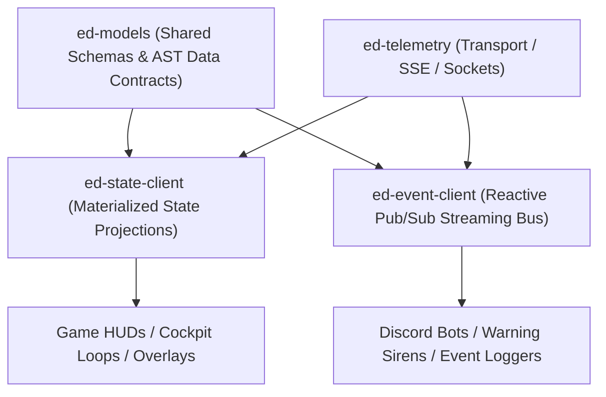

# Draft ADR: Decoupling Telemetry State Projections and Event Streaming Bus into Specialized Client Repositories

## 1. Context and Problem Statement

The current `ed-fleet-client` repository bundles two fundamentally distinct telemetry consumption paradigms into a single unified library and facade object (`EliteDangerousClient`):
1. **Synchronous State Engine & Reducers:** Passive, deterministic, in-memory materialized projections (`client.location`, `client.ship`, `client.session`) designed for game loops and high-frequency UI sampling.
2. **Asynchronous Reactive Event Bus:** Active, non-blocking pub/sub observer mechanisms (`@client.on(EventType)`, `client.subscribe()`) designed for notifications, alerts, audio cues, and side-effect delegation.

While both subsystems consume upstream *Elite Dangerous* telemetry (originating from `ed-telemetry` REST/SSE or WebSocket streams and typed via `ed-models`), their co-location within a single package introduces architectural and cognitive friction:
* **Conflation of Consumption Paradigms:** Developers struggle with competing mental models (push vs. pull). Subscribing to `@client.on(FSDJump)` feels redundant when `client.location.star_system` is also available, blurring the line between discrete past events and continuous ambient state.
* **Competing Operational Lifecycles:** An overlay HUD only needs instantaneous state sampling in RAM with zero overhead and does not need event queueing or listener callback loops. Conversely, a Discord bot or alert siren only needs discrete event triggers and does not require allocating memory for continuous 3D coordinate and orbital tracking projections.
* **Premature UX Facade Complexity:** Attempting to unify these two paradigms into an all-in-one developer facade (`EliteDangerousClient`) prematurely entangles transport lifecycle management, state mutation, invariant gating, and event dispatching before the underlying core primitives are independently stable and rigorously tested.

We require an architectural blueprint for decomposing this ecosystem into two focused, independent, and specialized client repositories: `ed-state-client` and `ed-event-client`. Constructing a higher-level composite SDK or developer facade is intentionally deferred until both specialized clients are fully implemented, benchmarked, and verified.

---

## 2. Proposed Dual-Repository Topology

The current monolithic client architecture will be split strictly into two focused domain packages:



### Repository Matrix

| Repository Name | Primary Paradigm | Core Responsibility | Key Invariants |
| :--- | :--- | :--- | :--- |
| `ed-state-client` | **Pull / Synchronous Sampling** | Ingest stream $\to$ Invariant Gate $\to$ Pure State Reducers $\to$ In-Memory RAM Projections | Zero async user callbacks; read operations take nanoseconds; pure functional reducers; immutable dataclass projections. |
| `ed-event-client` | **Push / Reactive Dispatch** | Ingest stream $\to$ Filter/Validate $\to$ Asynchronous Pub/Sub Fanout | Zero state retention; fire-and-forget concurrency; slowest listener cannot delay stream; no coordinate/loadout memory footprint. |

---

## 3. Detailed Repository Specifications

### A. Repository 1: `ed-state-client`

* **Repository Identity:** `github.com/mnaatjes/ed-state-client`
* **Target Audience:** Cockpit simulators, HUD overlays (Dear ImGui, Qt, Flutter), telemetry loggers, and immediate-mode render loops.
* **Scope & Boundaries:**
  * **Strictly In-Scope:** Wire transport ingestion; invariant flight regime gating (`validate_mutex_invariants()`); pure mathematical event reducers; typed dataclass state projections (`LocationProjection`, `ShipProjection`, `SessionProjection`).
  * **Strictly Out-of-Scope:** Event bus subscription, user callbacks (`@client.on`), discord alerts, arbitrary background user tasks, and astronomical route calculations.

#### Directory Topology
```
ed-state-client/
├── pyproject.toml
├── src/
│   └── ed_state_client/
│       ├── __init__.py                     # Exports StateClient, StateConfig, Projections
│       ├── core/
│       │   ├── domain/
│       │   │   ├── invariants.py           # Physical flight regime gates (Mutex validation)
│       │   │   ├── models.py               # Immutable State Projection dataclasses
│       │   │   └── reducers/               # Pure functional reducers (def reduce_*(current, event))
│       │   │       ├── location.py
│       │   │       ├── ship.py
│       │   │       ├── session.py
│       │   │       └── exploration.py
│       │   └── engine.py                   # Atomic in-memory state engine container
│       ├── ports/
│       │   ├── transport_port.py           # Ingestion wire contract
│       │   └── state_store_port.py         # State read contract
│       └── adapters/
│           ├── http_sse_transport.py       # Default driven transport for ed-telemetry
│           └── client.py                   # StateClient facade exposing .location, .ship, .session
└── tests/
```

#### Consumer Code Recipe
```python
from ed_state_client import StateClient

async with StateClient(url="http://localhost:8080/api/v1") as client:
    while True:
        # Instant synchronous read directly from RAM (nanoseconds)
        print(f"System: {client.location.star_system}, Docked: {client.location.docked}")
        await asyncio.sleep(0.5)
```

#### Key Concepts Covered
1. **Pure Reducer State Machines:** State transitions are isolated, deterministic functions with zero side effects ($S_{t+1} = \text{reduce}(S_t, E)$).
2. **Physical Invariant Enforcement:** Dropping corrupted or impossible telemetry packets prior to state mutation.
3. **Nanosecond In-Memory State Sampling:** Reading local RAM variables directly inside high-frequency game loops (60 FPS / 16ms) without async overhead.

---

### B. Repository 2: `ed-event-client`

* **Repository Identity:** `github.com/mnaatjes/ed-event-client`
* **Target Audience:** Automation bots (Discord, Twitch), spatial warning sirens, voice assistants, and reactive automation scripts.
* **Scope & Boundaries:**
  * **Strictly In-Scope:** Real-time socket/SSE stream ingestion; historical frame deduping/filtering; typed domain event fanout; listener subscription management (`@client.on(EventType)`, `subscribe()`); non-blocking background task scheduling.
  * **Strictly Out-of-Scope:** Long-term state caching; maintaining historical coordinates; ship loadout models; route calculation.

#### Directory Topology
```
ed-event-client/
├── pyproject.toml
├── src/
│   └── ed_event_client/
│       ├── __init__.py                     # Exports EventClient, EventConfig, Subscription
│       ├── core/
│       │   ├── dispatcher.py               # Fast in-memory pub/sub event registry
│       │   ├── models.py                   # Subscription metadata, handler type signatures
│       │   └── filters.py                  # Deduplication, historical timestamp filtering
│       ├── ports/
│       │   ├── transport_port.py           # Ingestion wire contract
│       │   └── dispatcher_port.py          # Pub/sub interface contract
│       └── adapters/
│           ├── http_sse_transport.py       # Default driven transport for ed-telemetry
│           └── client.py                   # EventClient exposing .on(), .subscribe(), .wait_for()
└── tests/
```

#### Consumer Code Recipe
```python
from ed_event_client import EventClient
from ed_models.events import FSDJump, UnderAttack

client = EventClient(url="http://localhost:8080/api/v1")

@client.on(FSDJump)
async def handle_jump(event: FSDJump) -> None:
    print(f"Jumped to: {event.star_system}")

@client.on(UnderAttack)
def handle_combat(event: UnderAttack) -> None:
    play_siren()

await client.start()
```

#### Key Concepts Covered
1. **Observer Decoupling:** Event producers and external consumer handlers have zero direct knowledge of each other.
2. **Fire-and-Forget Concurrency:** User listeners are scheduled via `asyncio.create_task()`, preventing slow consumer handlers from blocking network stream ingestion.
3. **One-Shot Awaiters (`wait_for`):** Coroutine futures that resolve when a specific game event occurs, ideal for procedural workflows.

---

## 4. Consequences and Trade-Offs

### Positive Consequences
* **Architectural & Cognitive Clarity:** Completely eradicates confusion between state reducers and the event bus by giving each its own discrete package and clean mental model.
* **Zero Overhead for Single-Purpose Apps:** Cockpit HUDs can depend solely on `ed-state-client` without pulling in event bus dispatchers. Notification bots can depend solely on `ed-event-client` without allocating state projection trees.
* **Independent Testability & Verification:** Each repository can establish isolated unit, integration, and performance test suites without mocking or coordinating cross-paradigm behavior.
* **Focused Release Cadence:** Changes to state reduction logic (e.g. tracking new inventory models) do not trigger new releases or breaking changes for event-streaming consumers.

### Deferred Concerns: High-Level Facade SDK
* Composing a unified facade SDK (e.g. `ed-fleet-sdk` or `EliteDangerousClient`) that binds both state and events under a single connection is explicitly deferred.
* Attempting facade composition prior to proving the operational boundaries of `ed-state-client` and `ed-event-client` creates premature coupling.
* Once both client libraries are independently verified, a composite facade can be evaluated as an optional orchestration layer.

---

## 5. Next Steps for Decision Finalization

1. Review and refine the dual-repository specifications with stakeholders.
2. Complete testing and stabilization of existing state reduction and event dispatch routines in the current codebase.
3. Establish repository infrastructure and CI pipelines for `ed-state-client` and `ed-event-client`.
4. Migrate code modules into their respective repositories.
