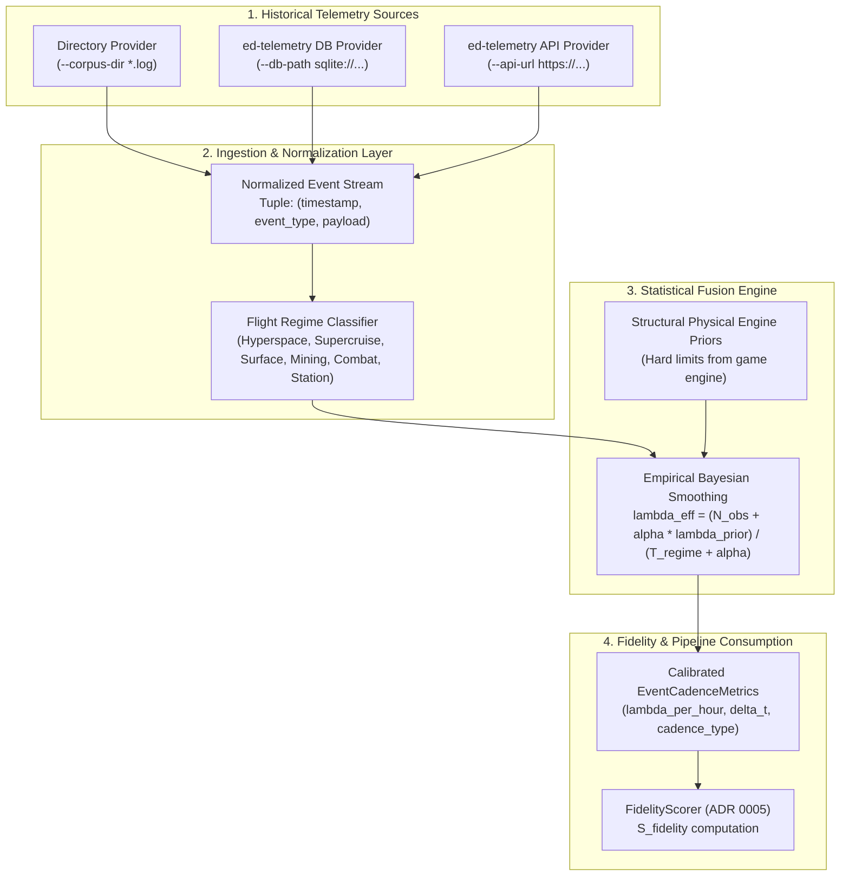

# Draft ADR: Empirical Flight Telemetry Ingestion, Bayesian Smoothing, and Regime-Conditioned Fidelity

## 1. Context and Problem Statement

In [ADR 0005](0005_property_event_fidelity_mapping_pipeline.md), we established a deterministic pipeline for deriving property-to-event relationships and computing multi-vector fidelity scores ($S_{\text{fidelity}}$). The pipeline currently utilizes structural code reflection from `ed-models` and game engine physical baselines (`DEFAULT_CADENCE_PROFILES`).

While physical engine baselines provide an invariant foundation, future development phases (such as dynamic cache TTL tuning, event backpressure sizing, and empirical telemetry validation) may benefit from ingesting real-world gameplay flight records.

However, ingesting empirical telemetry introduces critical failure modes:
1. **The Zero-Sample Distortion Trap:** If an event never appears in a specific historical sample, naive frequentist calculations yield a frequency of $0.00$ events/hour, falsely degrading authoritative snapshot events (such as `LoadGame`, `ShipyardSwap`, or `CarrierJump`) and corrupting downstream facade and reducer rankings.
2. **Gameplay Role Bias:** Elite Dangerous flight sessions reflect severe specialization (e.g., an explorer generates thousands of `FSDJump` and `Scan` events but zero `MiningRefined` or `AsteroidCracked` events). Dividing raw event counts by total flight hours skews role-specific rates toward zero.
3. **Coupling to Specific Storage Backends:** Historical telemetry may reside in local journal directory files (`Journal.*.log`), in a deployed `ed-telemetry` SQLite/PostgreSQL database, or behind a remote `ed-telemetry` HTTP REST API. Hardcoding one ingestion path degrades pipeline portability.

We require an architectural blueprint for future empirical telemetry ingestion that guarantees non-zero fallback safety, normalizes gameplay role bias, and preserves hexagonal boundary decoupling.

---

## 2. Decision Drivers

* **Zero-Sample Fallback Guarantee:** Under no circumstances may an unobserved or sparsely observed event produce a $0.00$ trigger frequency score or flip primary authority away from an authoritative model.
* **Role Conditioning & Bias Neutralization:** Event frequency must be evaluated relative to its operational context (e.g., mining events evaluated against active mining flight time, not total session time).
* **Hexagonal Decoupling of Ingestion Sources:** Ingestion logic must be pluggable, allowing consumption from directory corpora (`*.log`), relational databases (SQLite/PostgreSQL), or remote HTTP streaming APIs.
* **Temporal Stability:** The empirical pipeline must be optional and non-breaking, acting as a calibration layer on top of the deterministic AST schema foundations established in ADR 0005.

---

## 3. Decision Outcome

We specify an empirical telemetry ingestion extension architecture for `CorpusMiner` based on three core mechanisms:
1. **Pluggable Event Stream Providers:** A decoupled provider interface accepting local directory logs, `ed-telemetry` databases, or REST APIs.
2. **Empirical Bayesian Smoothing:** Blending observed counts with physical engine priors to mathematically eliminate $0.00$ scores.
3. **Regime-Conditioned Operational Windows:** Evaluating specialized gameplay events inside active role contexts rather than global elapsed flight time.



---

## 4. Mathematical Specifications

### 4.1 Empirical Bayesian Shrinkage (The Fallback Invariant)

To guarantee that unobserved events never drop to $0.00$ or destabilize the fidelity scoring equation, observed frequencies are smoothed using a conjugate Gamma-Poisson Bayesian prior:

$$\lambda_{\text{effective}} = \frac{N_{\text{observed}} + \alpha \cdot \lambda_{\text{prior}}}{T_{\text{context}} + \alpha}$$

Where:
* $N_{\text{observed}}$: The count of event instances recorded in the dataset.
* $T_{\text{context}}$: The total operational duration (in flight hours) for the event's regime.
* $\lambda_{\text{prior}}$: The physical game engine baseline rate (e.g. `FSDJump` = 12.0/hr, `CarrierJump` = 0.5/hr, `LoadGame` = 1.0/hr).
* $\alpha$: The pseudo-observation confidence parameter (recommended default: $\alpha = 5.0$ flight hours).

#### Mathematical Convergence Behavior:
1. **Zero Observations ($N_{\text{observed}} = 0$):**
   $$\lim_{N \to 0, T \to 0} \lambda_{\text{effective}} = \frac{0 + \alpha \cdot \lambda_{\text{prior}}}{0 + \alpha} = \lambda_{\text{prior}}$$
   The rate smoothly and exactly defaults to the structural engine baseline.
2. **Infinite Observations ($N_{\text{observed}} \gg \alpha \cdot \lambda_{\text{prior}}$):**
   $$\lim_{T \to \infty} \lambda_{\text{effective}} = \frac{N_{\text{observed}}}{T_{\text{context}}}$$
   The rate converges completely to the true observed flight behavior.

---

### 4.2 Regime-Conditioned Operational Windows

To eliminate player specialization bias, events are classified into six Operational Flight Regimes:

| Operational Regime | Activating Boundary Events | Member Events Evaluated |
| :--- | :--- | :--- |
| **Hyperspace / Travel** | `StartJump`, `FSDJump`, `CarrierJump` | `FSDJump`, `FSDTarget`, `FuelScoop`, `JetConeBoost` |
| **Supercruise Navigation** | `SupercruiseEntry`, `SupercruiseExit` | `ApproachBody`, `LeaveBody`, `DiscoveryScan`, `FSSDiscoveryScan` |
| **Surface & Planetary** | `Touchdown`, `Liftoff` | `Touchdown`, `Liftoff`, `ApproachSettlement`, `LaunchSRV` |
| **Station & Market** | `Docked`, `Undocked` | `Market`, `Shipyard`, `Outfitting`, `RepairAll`, `RefuelAll` |
| **Resource Extraction** | `LaunchDrone` (Prospector), `ProspectedAsteroid` | `ProspectedAsteroid`, `AsteroidCracked`, `MiningRefined` |
| **Tactical Combat** | `UnderAttack`, `ShipTargeted`, `CommitCrime` | `ShieldState`, `HullDamage`, `FactionKillBond`, `Bounty` |

The context duration $T_{\text{context}}$ is defined as:
$$T_{\text{context}} = \sum_{i \in \text{Regime Sessions}} \left( t_{\text{exit}}^{(i)} - t_{\text{entry}}^{(i)} \right)$$

*Result:* If a player corpus contains 50 hours of flight but only 30 minutes of mining, mining events are measured against $T_{\text{mining}} = 0.5\text{ hr}$, yielding true operational rates (~30–40 events/hour) rather than an artificially depressed 0.3 events/hour.

---

## 5. Hexagonal Ingestion Architecture

### 5.1 Provider Interface (`TelemetryStreamProvider`)

```python
from abc import ABC, abstractmethod
from collections.abc import AsyncIterator
from dataclasses import dataclass
from datetime import datetime


@dataclass(frozen=True)
class RawTelemetryRecord:
    timestamp: datetime
    event_type: str
    payload: dict[str, object]


class TelemetryStreamProvider(ABC):
    """Port for ingesting historical telemetry from arbitrary physical storage."""

    @abstractmethod
    async def stream_records(self) -> AsyncIterator[RawTelemetryRecord]:
        """Yield historical records in chronological order."""
        ...
```

### 5.2 Driving Adapters

1. **`DirectoryTelemetryAdapter`:** Streams newline-delimited JSON (`Journal.*.log`) and `Status.json` files off local disk using a generator.
2. **`DatabaseTelemetryAdapter`:** Connects to an `ed-telemetry` SQLite or PostgreSQL instance via SQLAlchemy/asyncpg, executing streamed chunked queries:
   ```sql
   SELECT event_timestamp, event_type, payload_json
   FROM telemetry_journal_events
   ORDER BY event_timestamp ASC;
   ```
3. **`HttpApiTelemetryAdapter`:** Connects to a deployed `ed-telemetry` service, paginating the REST endpoint:
   `GET /api/v1/telemetry/events?page_size=1000`.

---

## 6. Implementation Phasing & Status

* **Phase 1 (Current - ADR 0005 / SDD 0006):** In-memory physical engine baselines and AST reflection. No dependency on live or historical databases.
* **Phase 2 (Proposed - ADR 0006):**
  * Implement `TelemetryStreamProvider` and `DirectoryTelemetryAdapter`.
  * Implement `BayesianCadenceCalculator` with conjugate Gamma-Poisson smoothing.
  * Add `--db-path` and `--api-url` CLI arguments to `scripts/map_property_event_matrix.py`.

---

## 7. Consequences

### Positive
* **Robust Safety Floor:** Guaranteed mathematical convergence ensuring unobserved events never produce $0.00$ or corrupt property authority.
* **Bias-Free Mining:** Role-conditioned windowing ensures specialized gameplay (mining, combat) is scored accurately regardless of the test player's habits.
* **Pluggable Integration:** Direct integration path with `ed-telemetry` database or API without violating architectural boundaries.

### Negative / Trade-offs
* **Increased Complexity:** Requires maintaining regime state-machine classifiers during corpus ingestion.
* **Execution Time:** Processing multi-gigabyte historical databases requires asynchronous streaming to maintain pipeline performance.
