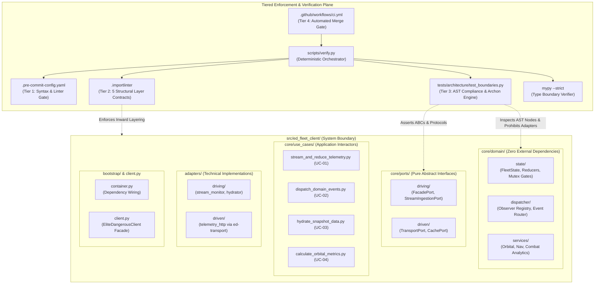
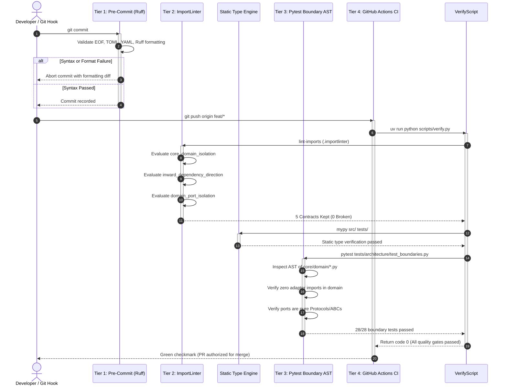
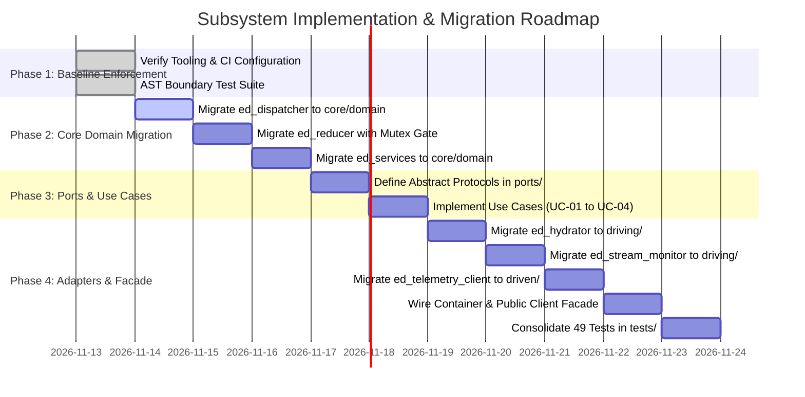

# SDD-001: Scope, Architectural Boundary, and Hexagonal Invariant Enforcement

## 1. Introduction and Architectural Motivation

### 1.1 Scope and Objective
This Software Design Document (SDD) specifies the concrete implementation architecture, Abstract Syntax Tree (AST) inspection visitors, ImportLinter contracts, and multi-tier verification pipelines that enforce the architectural scope and structural invariants of `ed-fleet-client`.

It serves as the definitive implementation design for:
* [ADR 0001: High-Level Hexagonal Architecture & Subsystem Integration](file:///home/michael/src/github.com/mnaatjes/ed-fleet-client/architecture/adr/0001_high_level_architecture.md)
* [ADR 0002: System Scope, Boundaries, and Multi-Tier Automated Enforcement](file:///home/michael/src/github.com/mnaatjes/ed-fleet-client/architecture/adr/0002_scope_boundaries_and_automated_enforcement.md)
* [ADR 0003: Submodule Migration and Hexagonal Architectural Realignment Plan](file:///home/michael/src/github.com/mnaatjes/ed-fleet-client/architecture/adr/0003_submodule_migration_and_hexagonal_realignment.md)

It translates the operational requirements of [UC-01 to UC-04](file:///home/michael/src/github.com/mnaatjes/ed-fleet-client/architecture/use-cases/) and mitigations for [RISK-01 through RISK-06](file:///home/michael/src/github.com/mnaatjes/ed-fleet-client/architecture/risk/risk-list.md) into mechanically verified quality gates.

### 1.2 The Skeptic Test (Why Build Automated Enforcement?)
In a distributed ecosystem combining flight telemetry, state machines, domain calculation engines, and network transport clients, human code review fails under delivery pressure:
1. **Accidental Outer Adapter Leaks into Core Domain (`RISK-05`):** Without automated guards, developers writing domain math (such as orbital velocity or route tracking) will naturally import `httpx`, `ed-transport`, or file-watching modules directly inside domain classes. This couples business rules to network transports and destroys offline testing.
2. **Corrupted State Ingestion (`RISK-01`):** Telemetry state engines that lack strict invariant gates will ingest corrupted status frames that claim physically impossible states (such as being `DOCKED` while simultaneously flying in `SUPERCRUISE`).
3. **Transport Daemon Coupling (`RISK-02`):** Allowing concrete HTTP client classes to bleed into application use cases prevents client applications from running in local file-watching mode when the REST daemon is offline.
4. **Scope Creep into Terminal Rendering:** Permitting `typer`, `rich`, or `textual` dependencies inside the core client facade duplicates functionality owned by `ed_cli_core` and bloats downstream headless bots or web overlays.

Enforcing architectural boundaries via pre-commit hooks, ImportLinter contracts, AST Pytest visitors, and CI pipelines mathematically eliminates these architectural failures prior to merging to `main`.

### 1.3 The Vacation Test
This specification details the contract rules, AST visitor algorithms, verification runner scripts, and phased pull-request milestones with sufficient technical depth that an independent engineer can implement, maintain, and extend these enforcement mechanisms without consulting the original author.

---

## 2. Visual Architecture Models

### 2.1 Structural Component Model



### 2.2 Dynamic Verification Flow Model



---

## 3. Subsystem Specifications & Contracts

### 3.1 Tier 1: Local Pre-Commit Authoring Gate (`.pre-commit-config.yaml`)
* **Role:** Instant feedback loop on developer workstations preventing syntactically invalid or unformatted code from entering the git history.
* **Configuration:**
  ```yaml
  repos:
    - repo: https://github.com/pre-commit/pre-commit-hooks
      rev: v5.0.0
      hooks:
        - id: trailing-whitespace
        - id: end-of-file-fixer
        - id: check-yaml
        - id: check-toml
    - repo: https://github.com/astral-sh/ruff-pre-commit
      rev: v0.7.3
      hooks:
        - id: ruff
          args: [--fix]
        - id: ruff-format
  ```

### 3.2 Tier 2: ImportLinter Layer Contracts (`.importlinter`)
* **Role:** Compile-time verification of package dependency geometry preventing architectural layer inversion.
* **Contracts:**
  1. **`core_domain_isolation` (Forbidden Contract):**
     * Source: `ed_fleet_client.core.domain`
     * Forbidden: `ed_fleet_client.adapters`, `external`, `frameworks`
     * Invariant: Pure domain entities, reducers, and services must never depend on infrastructure or outer adapters.
  2. **`inward_dependency_direction` (Layers Contract):**
     * Layer 1: `ed_fleet_client.adapters`
     * Layer 2: `ed_fleet_client.core.use_cases`
     * Layer 3: `ed_fleet_client.core.domain`
     * Invariant: Dependencies must flow strictly inward toward `core.domain`.
  3. **`domain_port_isolation` (Forbidden Contract):**
     * Source: `ed_fleet_client.core.domain`
     * Forbidden: `ed_fleet_client.core.ports`, `ed_fleet_client.core.use_cases`
     * Invariant: Core domain logic contains pure business rules and must not reference ports or orchestrating use cases.
  4. **`use_case_transport_isolation` (Forbidden Contract):**
     * Source: `ed_fleet_client.core.use_cases`
     * Forbidden: `ed_fleet_client.adapters`, `fastapi`, `starlette`, `flask`, `click`, `typer`
     * Invariant: Use cases orchestrate domain entities via ports, completely insulated from HTTP servers, CLI frameworks, or transport libraries.
  5. **`composition_root_isolation` (Forbidden Contract):**
     * Source: `ed_fleet_client.core.domain`, `ed_fleet_client.core.ports`, `ed_fleet_client.core.use_cases`, `ed_fleet_client.adapters`
     * Forbidden: `ed_fleet_client.bootstrap`
     * Invariant: The composition root (`bootstrap/container.py`) depends on all layers to wire dependencies, but no internal layer is permitted to import the composition root.

### 3.3 Tier 3: Pytest AST Compliance Engine (`tests/architecture/test_boundaries.py`)
* **Role:** Deep programmatic inspection of the Python AST to enforce invariants that linters cannot inspect.
* **Core Test Implementations:**
  * `test_core_domain_has_zero_external_dependencies()`: Parses AST of every file under `src/ed_fleet_client/core/domain/` to verify zero imports from `adapters`, `httpx`, `requests`, `ed_transport`, or terminal libraries.
  * `test_dependencies_point_strictly_inward()`: Ensures no file in `core/` references `adapters/`.
  * `test_ports_are_abstract_protocols_or_abcs()`: Analyzes all classes in `src/ed_fleet_client/core/ports/` to ensure every port class is either a `typing.Protocol` or inherits from `abc.ABC`, and that all defined public methods have no concrete implementation bodies.
  * `test_external_terminal_frameworks_banned_from_client_core()`: Explicitly scans for `typer`, `rich`, `textual`, or `click` imports inside `src/ed_fleet_client/core/`, ensuring terminal UI rendering remains isolated in `ed_cli_core`.

### 3.4 Tier 4: Continuous Integration & Verification Runner (`scripts/verify.py` & `ci.yml`)
* **Role:** Single, deterministic command executed identically in local developer environments and GitHub Actions CI.
* **Execution Sequence:**
  ```text
  scripts/verify.py
  ├── 1. pre-commit run --all-files     (Tier 1: formatting and syntax)
  ├── 2. lint-imports                   (Tier 2: layer boundary validation)
  ├── 3. mypy src/ tests/               (Static type boundary check)
  └── 4. pytest tests/                  (Tier 3: unit, integration & boundary tests)
  ```

---

## 4. Implementation Plan & PR Sequencing



### Milestone 1: Enforcement Baseline (Current Branch: `feat/sdd-scope-boundary-enforcement`)
* [x] Initialize repository from `python-hexagonal-template`.
* [x] Configure `.pre-commit-config.yaml` and `.importlinter`.
* [x] Establish AST boundary tests in `tests/architecture/test_boundaries.py`.
* [x] Author ADR 0001, ADR 0002, ADR 0003, and SDD-001.
* [x] Verify `scripts/verify.py` passes all gates with zero errors.

### Milestone 2: Core Domain Realignment (Branch: `feat/migrate-core-domain`)
* [ ] Add `ed-models` and `ed-transport` dependencies to `pyproject.toml`.
* [ ] Copy and refactor `ed_dispatcher` into `src/ed_fleet_client/core/domain/dispatcher/`.
* [ ] Copy and refactor `ed_reducer` into `src/ed_fleet_client/core/domain/state/`, embedding the Mutex Invariant validation gate from ADR 0014 and Research 0001.
* [ ] Copy and refactor `ed_services` into `src/ed_fleet_client/core/domain/services/`.
* [ ] Verify that `lint-imports` confirms zero adapter dependencies in `core/domain`.

### Milestone 3: Ports & Use Cases Definition (Branch: `feat/ports-and-use-cases`)
* [ ] Define abstract protocols in `src/ed_fleet_client/core/ports/driving/` (`FacadePort`, `StreamPort`).
* [ ] Define abstract protocols in `src/ed_fleet_client/core/ports/driven/` (`TransportPort`, `StoragePort`).
* [ ] Implement use case interactors in `src/ed_fleet_client/core/use_cases/` implementing UC-01 through UC-04.

### Milestone 4: Adapters Realignment & Facade Integration (Branch: `feat/adapters-and-facade`)
* [ ] Migrate `ed_hydrator` into `src/ed_fleet_client/adapters/driving/hydrator/`.
* [ ] Migrate `ed_stream_monitor` into `src/ed_fleet_client/adapters/driving/stream/`.
* [ ] Migrate `ed_telemetry_client` into `src/ed_fleet_client/adapters/driven/telemetry_http/`.
* [ ] Wire composition root in `src/ed_fleet_client/bootstrap/container.py`.
* [ ] Implement `EliteDangerousClient` facade in `src/ed_fleet_client/client.py`.
* [ ] Migrate and execute all unit and integration tests under `tests/unit/` and `tests/integration/`.

---

## 5. Traceability and Quality Invariants

* **Upstream Decisions:** Direct realization of [ADR 0001](file:///home/michael/src/github.com/mnaatjes/ed-fleet-client/architecture/adr/0001_high_level_architecture.md), [ADR 0002](file:///home/michael/src/github.com/mnaatjes/ed-fleet-client/architecture/adr/0002_scope_boundaries_and_automated_enforcement.md), and [ADR 0003](file:///home/michael/src/github.com/mnaatjes/ed-fleet-client/architecture/adr/0003_submodule_migration_and_hexagonal_realignment.md).
* **Requirements Satisfied:** Implements architectural backing for [UC-01](file:///home/michael/src/github.com/mnaatjes/ed-fleet-client/architecture/use-cases/UC-01_stream_and_reduce_telemetry_state.md), [UC-02](file:///home/michael/src/github.com/mnaatjes/ed-fleet-client/architecture/use-cases/UC-02_dispatch_domain_events_to_observers.md), [UC-03](file:///home/michael/src/github.com/mnaatjes/ed-fleet-client/architecture/use-cases/UC-03_hydrate_snapshot_and_market_data.md), and [UC-04](file:///home/michael/src/github.com/mnaatjes/ed-fleet-client/architecture/use-cases/UC-04_calculate_orbital_and_nav_metrics.md).
* **Risks Mitigated:**
  * **RISK-01:** Mitigated via in-scope Mutex Invariant validation in `core/domain/state/`.
  * **RISK-02:** Mitigated via strict port decoupling between facade and HTTP transport.
  * **RISK-05:** Mitigated via Tier 2 ImportLinter contracts and Tier 3 AST compliance suite.
