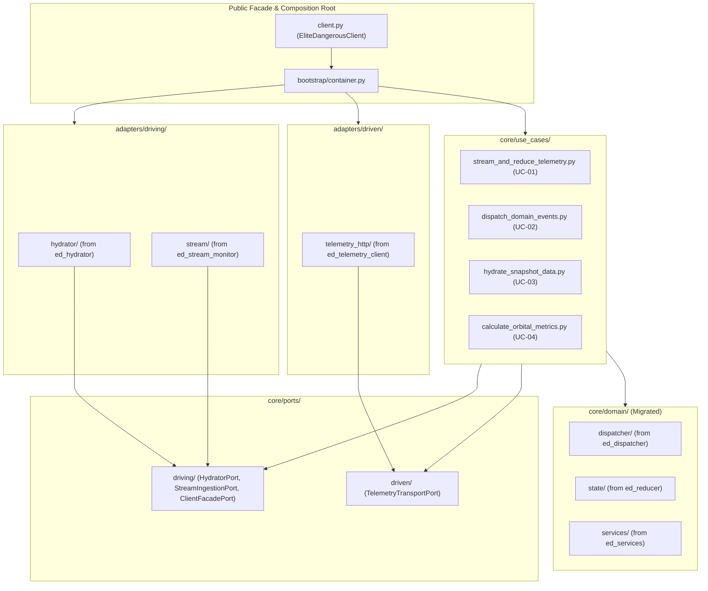
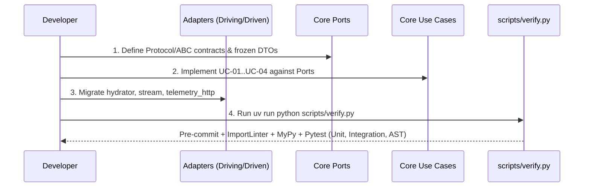

# SDD 0002: Submodule Integration and Testing Procedure

* **Status:** Proposed
* **Date:** 2026-11-15
* **Related ADRs:** [ADR 0001](../adr/0001_high_level_architecture.md), [ADR 0002](../adr/0002_scope_boundaries_and_automated_enforcement.md), [ADR 0003](../adr/0003_submodule_migration_and_hexagonal_realignment.md)
* **Related Use Cases:** [UC-01](../use-cases/UC-01_stream_and_reduce_telemetry.md), [UC-02](../use-cases/UC-02_dispatch_domain_events.md), [UC-03](../use-cases/UC-03_hydrate_snapshot_data.md), [UC-04](../use-cases/UC-04_calculate_orbital_metrics.md)
* **Related Risks:** [Master Risk Register](../risk/risk-list.md) (RISK-01 through RISK-05)

---

## 1. Introduction & Context

### 1.1 Purpose

This Software Design Document (SDD) defines the end-to-end engineering procedure for integrating all seven prototype submodules from `ed-integration-smoke` into the hexagonal architecture of `ed-fleet-client`, together with the multi-layer testing procedure required to verify correctness and architectural compliance.

### 1.2 The Skeptic Test

Prototype submodules in `ed-integration-smoke` were authored as standalone packages with direct cross-package imports (for example, `ed_stream_monitor` importing `ed_telemetry_client` directly, and `ed_fleet_client` instantiating concrete HTTP clients). Copying those modules verbatim into `src/ed_fleet_client/` would violate ImportLinter contracts, break `tests/architecture/test_boundaries.py`, and couple domain logic to HTTP transport. This SDD establishes the exact port abstractions, adapter wrappers, composition root wiring, and test-double strategy needed to complete the migration cleanly.

---

## 2. Submodule Integration Topology



---

## 3. Submodule-by-Submodule Integration Specification

### 3.1 Core Domain Submodules (Migrated)

1. **`ed_dispatcher` $\to$ `src/ed_fleet_client/core/domain/dispatcher/`**
   * **Status:** Migrated.
   * **Files:** `dispatcher.py`, `models.py`, `__init__.py`.
   * **Invariants:** Zero external adapter imports; synchronous `dispatch()` schedules async handlers on an active loop or raises `RuntimeError` rather than calling `asyncio.run()`.
   * **Tests:** `tests/unit/core/test_dispatcher.py` (7 unit tests).

2. **`ed_reducer` $\to$ `src/ed_fleet_client/core/domain/state/`**
   * **Status:** Migrated.
   * **Files:** `engine.py`, `reducers.py`, `models.py`, `__init__.py`.
   * **Invariants:** Enforces pre-reduction Mutex Invariant validation (`validate_mutex_invariants`) in `engine.py` (mitigating RISK-01).
   * **Tests:** `tests/unit/core/test_engine.py`, `tests/unit/core/test_reducers.py` (6 unit tests).

3. **`ed_services` $\to$ `src/ed_fleet_client/core/domain/services/`**
   * **Status:** Migrated.
   * **Files:** `base.py`, `models.py`, `navigation.py`, `orbital.py`, `astrophysics.py`, `flight_performance.py`, `combat_analytics.py`, `__init__.py`.
   * **Invariants:** Uses relative imports (`..dispatcher`, `..state`) and self-validating dataclasses.
   * **Tests:** `tests/unit/core/services/{test_analytics.py, test_navigation.py, test_orbital.py}` (10 unit tests).

### 3.2 Ports & Use Cases (Milestone 3 — Pending)

Before migrating the remaining four submodules, define abstract contracts in `src/ed_fleet_client/core/ports/` and orchestrators in `src/ed_fleet_client/core/use_cases/`:

1. **Driving Ports (`core/ports/driving/`):**
   * `hydrator_port.py`: `HydratorPort` (`Protocol` / `ABC`) defining `hydrate_journal_event(raw: dict[str, Any]) -> TelemetryEvent` and `hydrate_snapshot(name: str, raw: dict[str, Any]) -> BaseModel`.
   * `stream_port.py`: `StreamIngestionPort` (`Protocol` / `ABC`) defining `start()`, `stop()`, and event callback registration.
   * `client_port.py`: `ClientFacadePort` (`Protocol` / `ABC`) defining public query and subscription contracts.

2. **Driven Ports (`core/ports/driven/`):**
   * `telemetry_transport_port.py`: `TelemetryTransportPort` (`Protocol` / `ABC`) defining `fetch_status()`, `fetch_snapshot(endpoint: str)`, and `stream_events()`.

3. **Use Cases (`core/use_cases/`):**
   * `stream_and_reduce_telemetry.py`: Orchestrates `StreamIngestionPort` + `TelemetryStateEngine` (UC-01).
   * `dispatch_domain_events.py`: Orchestrates `TelemetryEventDispatcher` event routing (UC-02).
   * `hydrate_snapshot_data.py`: Orchestrates `TelemetryTransportPort` + `HydratorPort` (UC-03).
   * `calculate_orbital_metrics.py`: Orchestrates `OrbitalMechanicsService` and domain services (UC-04).

### 3.3 Driving & Driven Adapters (Milestone 4 — Pending)

1. **`ed_hydrator` $\to$ `src/ed_fleet_client/adapters/driving/hydrator/`**
   * **Source:** `src/ed_hydrator/ed_hydrator/{hydrator.py, models.py, __init__.py}`.
   * **Integration Procedure:**
     1. Copy source files into `adapters/driving/hydrator/`.
     2. Implement `HydratorPort` from `core.ports.driving.hydrator_port`.
     3. Preserve resilient `extra="allow"` parsing for companion snapshots (`ExtendedMarket`, etc.) per RISK-03.
   * **Tests:** `tests/unit/adapters/test_hydrator.py`.

2. **`ed_stream_monitor` $\to$ `src/ed_fleet_client/adapters/driving/stream/`**
   * **Source:** `src/ed_stream_monitor/ed_stream_monitor/{monitor.py, models.py, __init__.py}`.
   * **Integration Procedure:**
     1. Copy source files into `adapters/driving/stream/`.
     2. Implement `StreamIngestionPort` from `core.ports.driving.stream_port`.
     3. Replace direct `ed_telemetry_client` imports with constructor-injected `TelemetryTransportPort`.
   * **Tests:** `tests/unit/adapters/test_stream_monitor.py`.

3. **`ed_telemetry_client` $\to$ `src/ed_fleet_client/adapters/driven/telemetry_http/`**
   * **Source:** `src/ed_telemetry_client/ed_telemetry_client/{client.py, middleware.py, models.py, __init__.py}`.
   * **Integration Procedure:**
     1. Copy source files into `adapters/driven/telemetry_http/`.
     2. Implement `TelemetryTransportPort` from `core.ports.driven.telemetry_transport_port`.
     3. Keep `httpx` and `ed-transport` dependencies strictly isolated inside `adapters/driven/telemetry_http/`.
   * **Tests:** `tests/unit/adapters/test_telemetry_http_client.py`.

### 3.4 Composition Root & Public Facade (Milestone 4 — Pending)

1. **`ed_fleet_client` $\to$ `src/ed_fleet_client/bootstrap/container.py` & `src/ed_fleet_client/client.py`**
   * **Source:** `src/ed_fleet_client/ed_fleet_client/client.py`.
   * **Integration Procedure:**
     1. Wire concrete adapters (`TelemetryHttpClient`, `StreamMonitor`, `TelemetryHydrator`) to ports and use cases inside `bootstrap/container.py`.
     2. Refactor `EliteDangerousClient` in `client.py` to delegate to use cases and ports rather than instantiating concrete HTTP clients directly.
     3. Export `EliteDangerousClient` from `src/ed_fleet_client/__init__.py`.
   * **Tests:** `tests/integration/test_client_facade.py`.

---

## 4. Dynamic Integration & Verification Flow



---

## 5. Testing Procedure

### 5.1 Test Pyramid & Directory Layout

* **Architectural Boundary Tests (`tests/architecture/test_boundaries.py`):**
  * Enforces zero external dependencies in `core/domain/`, inward dependency direction, abstract-only ports, frozen DTOs, and zero lifecycle pollution.
* **In-Memory Test Doubles (`tests/doubles/`):**
  * Provide in-memory fakes (for example, `InMemoryTelemetryTransportPort`, `FakeHydratorPort`) for every driven and driving port so use cases and facade integration tests run 100% offline.
* **Unit Tests (`tests/unit/`):**
  * `tests/unit/core/`: Tests domain entities, dispatcher, state engine, reducers, and domain services (23 tests currently passing).
  * `tests/unit/use_cases/`: Tests `UC-01` through `UC-04` using in-memory test doubles.
  * `tests/unit/adapters/`: Tests `hydrator`, `stream_monitor`, and `telemetry_http` (with mocked `httpx` transport).
* **Integration Tests (`tests/integration/`):**
  * `tests/integration/test_client_facade.py`: Verifies end-to-end `EliteDangerousClient` wiring through `bootstrap/container.py`.

### 5.2 Deterministic Verification Gate

Every milestone PR must pass the full verification runner before merge:

```bash
uv run python scripts/verify.py
```

This executes in order:
1. `pre-commit run --all-files` (trailing whitespace, EOF, YAML/TOML, Ruff lint & format)
2. `lint-imports` (ImportLinter 5/5 contracts)
3. `mypy src/ tests/` (strict static type checking)
4. `pytest tests/` (architectural boundary suite + unit tests + integration tests)
