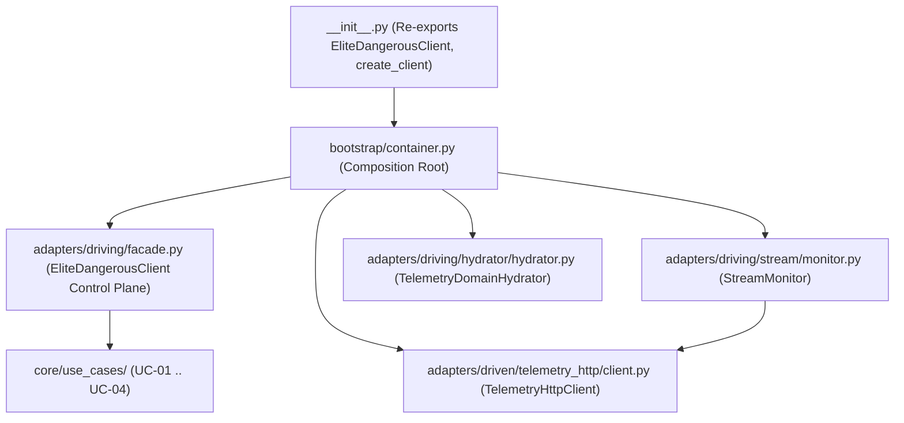
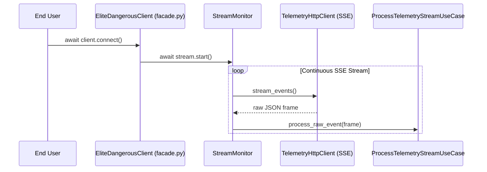

# SDD 0003: Facade Control Plane and Driving Adapter Completion

* **Status:** Approved
* **Date:** 2026-11-15
* **Related ADRs:** [ADR 0001](../adr/0001_high_level_architecture.md), [ADR 0002](../adr/0002_scope_boundaries_and_automated_enforcement.md), [ADR 0003](../adr/0003_submodule_migration_and_hexagonal_realignment.md)
* **Related Use Cases:** [UC-01](../use-cases/UC-01_stream_and_reduce_telemetry.md), [UC-02](../use-cases/UC-02_dispatch_domain_events.md), [UC-03](../use-cases/UC-03_hydrate_snapshot_data.md), [UC-04](../use-cases/UC-04_calculate_orbital_metrics.md)
* **Related Risks:** [Master Risk Register](../risk/risk-list.md) (RISK-01 through RISK-05)

---

## 1. Introduction & Context

### 1.1 Purpose

This SDD specifies the completion of the driving-side architecture in `ed-fleet-client`:
1. Relocating the public facade (`EliteDangerousClient`) to `src/ed_fleet_client/adapters/driving/facade.py` as the unified control plane.
2. Upgrading `StreamMonitor` and `TelemetryHttpClient` for continuous SSE streaming with reconnect backoff.
3. Adding resilient `extra="allow"` typed companion snapshot hydration in `TelemetryDomainHydrator`.
4. Adding offline unit tests for `UC-01` through `UC-04` under `tests/unit/use_cases/`.

### 1.2 The Skeptic Test

Keeping `client.py` at the package root breaks symmetry with sibling repositories (such as `ed-models` where the facade resides in `adapters/driving/facade.py`). Furthermore, polling a single `get_state()` snapshot does not satisfy real-time SSE streaming requirements, and untyped `RawSnapshotRecord` wrappers leave `UC-03` incomplete.

---

## 2. Structural & Dynamic Models

---

## 3. Implementation Specification

### 3.1 Facade Control Plane (`adapters/driving/facade.py`)
* Move `src/ed_fleet_client/client.py` $\to$ `src/ed_fleet_client/adapters/driving/facade.py`.
* Inject `GetHydratedSnapshotUseCase` (`UC-03`) into `EliteDangerousClient` and expose `async def get_snapshot(self, name: str, endpoint: str) -> Any`.
* Update `bootstrap/container.py` and `__init__.py` to reference `adapters.driving.facade.EliteDangerousClient`.

### 3.2 Continuous SSE Streaming (`StreamMonitor` & `TelemetryHttpClient`)
* Update `TelemetryHttpClient.stream_events()` to stream SSE `data:` frames over `httpx` (with graceful fallback to `get_state()` when using synchronous mock transports).
* Update `StreamMonitor._run_loop()` to consume `stream_events()` continuously and apply `reconnect_delay_seconds` backoff on transient errors.

### 3.3 Resilient Snapshot Hydration (`TelemetryDomainHydrator`)
* Add a Pydantic `ResilientSnapshotModel` (`ConfigDict(extra="allow")`) in `adapters/driving/hydrator/models.py` for typed companion snapshot hydration in `hydrate_snapshot()`, preserving `RawSnapshotRecord` compatibility.

### 3.4 Use-Case Unit Tests (`tests/unit/use_cases/`)
* Add `tests/unit/use_cases/test_use_cases.py` covering `UC-01` through `UC-04` using `InMemoryTelemetryTransportPort`.
