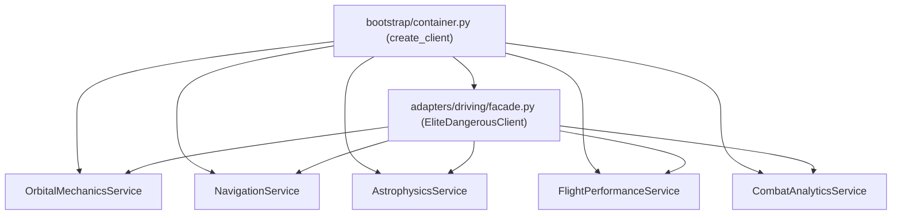
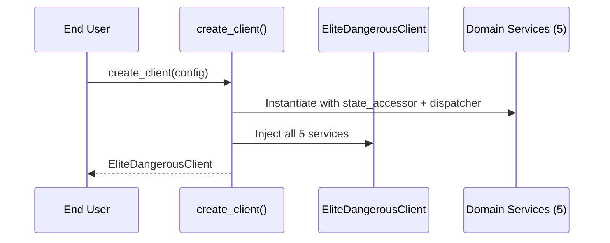

# SDD 0004: Bootstrap Remaining Domain Services in Composition Root

* **Status:** Approved
* **Date:** 2026-11-15
* **Related ADRs:** [ADR 0001](../adr/0001_high_level_architecture.md), [ADR 0002](../adr/0002_scope_boundaries_and_automated_enforcement.md), [ADR 0003](../adr/0003_submodule_migration_and_hexagonal_realignment.md)
* **Related Use Cases:** [UC-01](../use-cases/UC-01_stream_and_reduce_telemetry.md), [UC-02](../use-cases/UC-02_dispatch_domain_events.md), [UC-04](../use-cases/UC-04_calculate_orbital_metrics.md)
* **Related Risks:** [Master Risk Register](../risk/risk-list.md)

---

## 1. Introduction & Context

### 1.1 Purpose

`NavigationService`, `AstrophysicsService`, `FlightPerformanceService`, and `CombatAnalyticsService` are implemented and unit-tested under `src/ed_fleet_client/core/domain/services/`, but are not yet instantiated in `bootstrap/container.py` or exposed on `EliteDangerousClient`. This SDD specifies wiring all five domain services into the composition root and exposing them on the facade control plane.

### 1.2 The Skeptic Test

Without wiring these services in `create_client()`, end users must manually instantiate them with `state_accessor` and `dispatcher`, defeating the purpose of the unified `EliteDangerousClient` facade.

---

## 2. Structural & Dynamic Models

---

## 3. Implementation Specification

1. **`src/ed_fleet_client/bootstrap/container.py`:**
   * Instantiate `NavigationService`, `AstrophysicsService`, `FlightPerformanceService`, and `CombatAnalyticsService` alongside `OrbitalMechanicsService` using `state_accessor=lambda: state_engine.current` and `dispatcher=dispatcher`.
   * Pass all four services into `EliteDangerousClient`.
2. **`src/ed_fleet_client/adapters/driving/facade.py`:**
   * Expose `navigation`, `astrophysics`, `flight_performance`, and `combat_analytics` read-only properties on `EliteDangerousClient`.
3. **`tests/integration/test_client_facade.py`:**
   * Assert all five domain services are wired and non-None on `create_client()`.
