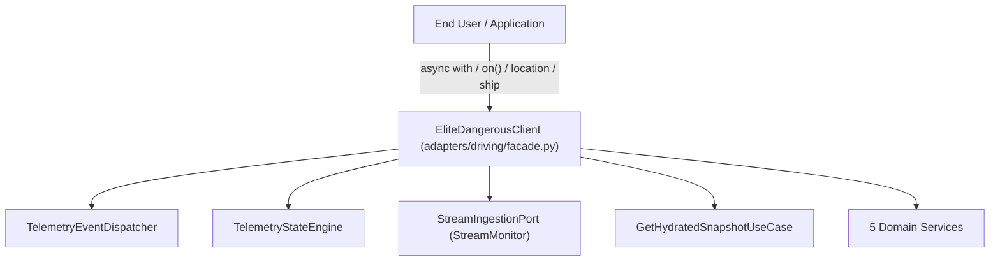
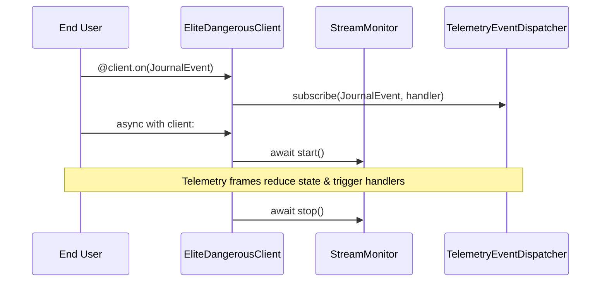

# SDD 0005: End-User Control Plane Facade & Diataxis Documentation Implementation

* **Status:** Proposed
* **Date:** 2026-11-15
* **Related ADRs:** [ADR 0004](../adr/0004_end_user_control_plane_facade.md), [ADR 0001](../adr/0001_high_level_architecture.md), [ADR 0002](../adr/0002_scope_boundaries_and_automated_enforcement.md)
* **Related Use Cases:** [UC-01](../use-cases/UC-01_stream_and_reduce_telemetry.md), [UC-02](../use-cases/UC-02_dispatch_domain_events.md), [UC-03](../use-cases/UC-03_hydrate_snapshot_data.md), [UC-04](../use-cases/UC-04_calculate_orbital_metrics.md)
* **Related Risks:** [Master Risk Register](../risk/risk-list.md)

---

## 1. Introduction & Context

### 1.1 Purpose

This SDD specifies the concrete implementation of [ADR 0004](../adr/0004_end_user_control_plane_facade.md):
1. Extending `EliteDangerousClient` (`src/ed_fleet_client/adapters/driving/facade.py`) with ergonomic lifecycle (`__aenter__`/`__aexit__`), event-listener (`on()`, `subscribe()`, `unsubscribe()`), and state-projection (`location`, `session`, `ship`) methods/properties.
2. Expanding `tests/integration/test_client_facade.py` to verify all facade UX methods offline.
3. Authoring the four Diataxis documents under `docs/` (`tutorials/`, `how-to/`, `reference/`).

### 1.2 The Skeptic Test

Without these facade-level delegations, users must reach into `client.dispatcher.on(...)` and `client.state.location` manually, and have no `async with create_client()` lifecycle management or user-facing `docs/` guides.

---

## 2. Structural & Dynamic Models

---

## 3. Implementation Specification

### 3.1 Facade UX Methods (`src/ed_fleet_client/adapters/driving/facade.py`)
* **Async Context Manager:**
  * `async def __aenter__(self) -> EliteDangerousClient`: Calls `await self.connect()` and returns `self`.
  * `async def __aexit__(self, exc_type: Any, exc_val: Any, exc_tb: Any) -> None`: Calls `await self.disconnect()`.
* **Event Listener Delegation:**
  * `def on(self, event_type: type[E]) -> Callable[[EventHandler], EventHandler]`: Delegates to `self._dispatcher.on(event_type)`.
  * `def subscribe(self, event_type: type[E], handler: EventHandler) -> Subscription`: Delegates to `self._dispatcher.subscribe(event_type, handler)`.
  * `def unsubscribe(self, subscription: Subscription) -> bool`: Delegates to `self._dispatcher.unsubscribe(subscription)`.
* **State Projection Properties:**
  * `location -> LocationProjection`: Returns `self._state_engine.location`.
  * `session -> SessionProjection`: Returns `self._state_engine.session`.
  * `ship -> ShipProjection`: Returns `self._state_engine.ship`.

### 3.2 Testing Procedure (`tests/integration/test_client_facade.py`)
* Test `async with create_client() as client:` lifecycle.
* Test `@client.on(JournalEvent)`, `client.subscribe(...)`, and `client.unsubscribe(...)`.
* Test `client.location`, `client.session`, and `client.ship` properties.
* Run `uv run python scripts/verify.py` (Pre-commit, ImportLinter, MyPy, Pytest).

### 3.3 Diataxis Documentation (`docs/`)
* `docs/tutorials/getting_started_with_ed_fleet_client.md`
* `docs/how-to/connect_to_ed_telemetry.md`
* `docs/how-to/subscribe_to_telemetry_events.md`
* `docs/reference/client_facade.md`
