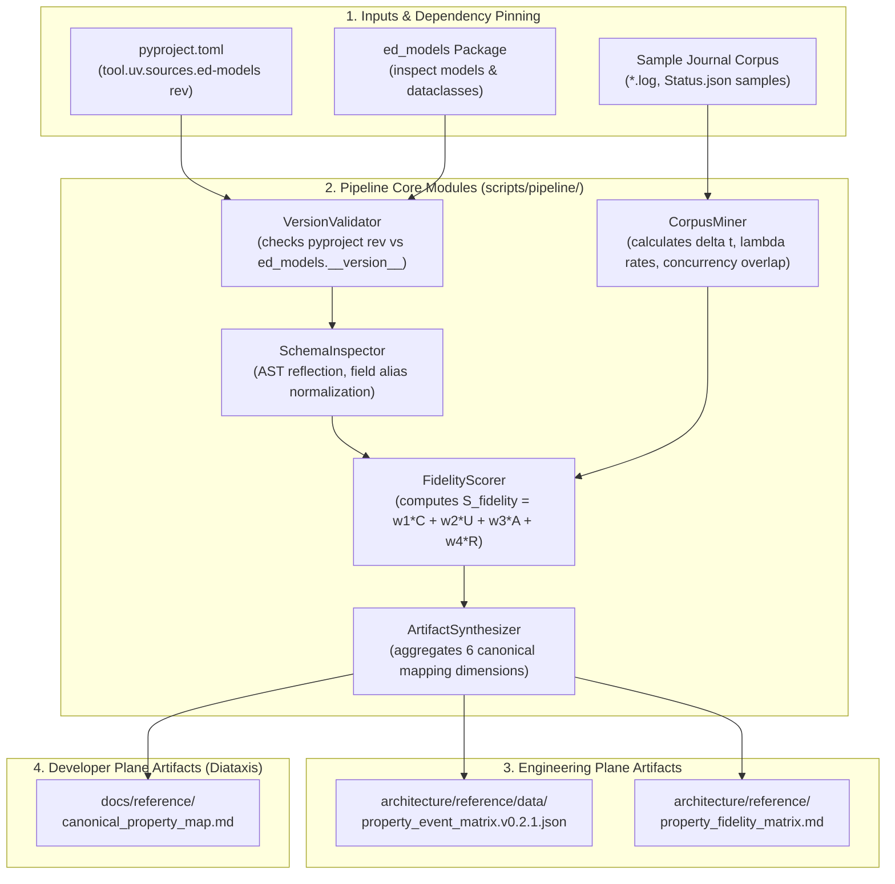
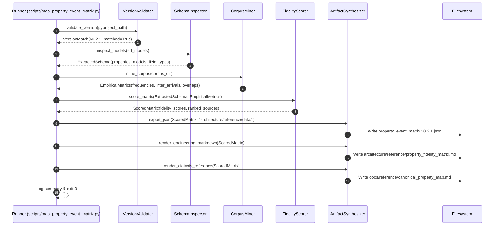

# SDD 0006: Deterministic Telemetry Property-to-Event Derivation & Fidelity Mapping Pipeline

* **Status:** Proposed
* **Date:** 2026-11-22
* **Related ADRs:** [ADR 0005](../adr/0005_property_event_fidelity_mapping_pipeline.md), [ADR 0004](../adr/0004_end_user_control_plane_facade.md), [ADR 0001](../adr/0001_high_level_architecture.md), [ADR 0002](../adr/0002_scope_boundaries_and_automated_enforcement.md)
* **Related Use Cases:** [UC-01](../use-cases/UC-01_stream_and_reduce_telemetry.md), [UC-02](../use-cases/UC-02_dispatch_domain_events.md), [UC-03](../use-cases/UC-03_hydrate_snapshot_data.md)
* **Related Risks:** [Master Risk Register](../risk/risk-list.md)

---

## 1. Introduction & Context

### 1.1 Purpose

This Software Design Document specifies the end-to-end implementation architecture for the deterministic telemetry derivation and fidelity mapping pipeline approved in [ADR 0005](../adr/0005_property_event_fidelity_mapping_pipeline.md).

The pipeline extracts, quantifies, and synthesizes the **6 Canonical Mapping Dimensions** (Sources, Importance, Frequency/Resolution, Freshness, Concurrency, and Fidelity) from the version-pinned `ed-models` package and real-world telemetry journal corpora. It produces versioned, traversible JSON graphs for algorithmic consumption and Markdown reference documentation across both the internal Engineering Plane (`architecture/reference/`) and developer-facing Diataxis Reference Plane (`docs/reference/`).

### 1.2 The Skeptic Test

Why build an automated data pipeline instead of authoring property-to-event documentation by hand?

1. **Model Drift:** Upstream `ed-models` represents ~285 event schemas and continuous `Status.json` telemetry. Hand-written mapping becomes outdated with every game update or model revision.
2. **Multi-Source Ambiguity:** Properties such as `star_system` appear concurrently in 5 distinct event streams (`FSDJump`, `Location`, `CarrierJump`, `NavRoute`, and `Status.json`). Guessing which event is freshest or most reliable causes reducer bugs and stale projections.
3. **Traceability:** Without an automated extraction and scoring script, proposed facade convenience methods (e.g. `client.get_current_system()`) lack verified backing reducers and provable fidelity scores.

---

## 2. Structural & Dynamic Models

### 2.1 Structural Pipeline Architecture

### 2.2 Dynamic Execution Sequence

---

## 3. Detailed Component Design

### 3.1 Component 1: `VersionValidator`

* **Location:** `scripts/pipeline/version_validator.py`
* **Responsibilities:**
  * Parse `pyproject.toml` in the repository root to find `[tool.uv.sources.ed-models]`.
  * Extract the expected git revision tag (e.g. `rev = "v0.2.1"`).
  * Import `ed_models` and read `getattr(ed_models, "__version__", "unknown")`.
  * Abort with clear remediation instructions if the installed virtual environment package mismatches the pinned revision in `pyproject.toml`.

### 3.2 Component 2: `SchemaInspector`

* **Location:** `scripts/pipeline/schema_inspector.py`
* **Responsibilities:**
  * Walk all module members of `ed_models.events` and `ed_models.status`.
  * Extract all dataclass/Pydantic fields, nested models, optionality, and type annotations.
  * Apply property alias normalization dictionary (e.g. `StarSystem` -> `star_system`, `Destination.Name` -> `star_system`, `CurrentSystem` -> `star_system`).
  * Classify properties into 4 functional tiers:
    * **Tier 1:** Core Navigation & Spatial State (`star_system`, `system_address`, `coordinates`, `ship_model`, `cmdr_name`, `docked`).
    * **Tier 2:** Operational Vessel Telemetry (`fuel_main`, `fuel_reservoir`, `pips`, `hull_health`, `shield_health`, `heading`, `altitude`).
    * **Tier 3:** Contextual & Economy (`market_id`, `station_name`, `economy`, `allegiance`, `security`).
    * **Tier 4:** Ephemeral & Transient (`music_track`, `dialogue_line`, `minor_flags`).

### 3.3 Component 3: `CorpusMiner`

* **Location:** `scripts/pipeline/corpus_miner.py`
* **Responsibilities:**
  * Ingest sample journal logs (`Journal.*.log`) and status telemetry files (`Status.json`) from a configurable corpus directory (e.g., `tests/fixtures/journals/`).
  * Calculate trigger frequency $\lambda_{\text{event}}$ (events per flight hour).
  * Calculate inter-arrival time distributions ($\Delta t_{50}$, $\Delta t_{90}$, $\Delta t_{99}$).
  * Measure event concurrency and calculate Jaccard overlap:
    $$J(A, B) = \frac{|P_A \cap P_B|}{|P_A \cup P_B|}$$
  * Quantify freshness latency ($\Delta t_{\text{latency}}$) between status polls and journal write events.

### 3.4 Component 4: `FidelityScorer`

* **Location:** `scripts/pipeline/fidelity_scorer.py`
* **Responsibilities:**
  * Score each (property, event) tuple across 4 weighted vectors:
    1. **Completeness ($C$):** $1.0$ if non-null in all instances, $0.5$ if optional, $0.0$ if conditional.
    2. **Uniqueness ($U$):** $1.0$ for authoritative 64-bit Frontier IDs (`SystemAddress`, `MarketID`), $0.7$ for canonical strings, $0.3$ for localized strings.
    3. **Phase Accuracy ($A$):** $1.0$ if strictly emitted post-transition, $0.5$ if pre-transition or transitional intent (`StartJump`).
    4. **Recency ($R$):** $1.0$ for streaming sub-second polls, scaled down by inter-arrival $\Delta t$.
  * Compute Composite Fidelity Score:
    $$S_{\text{fidelity}} = 0.35 \cdot C + 0.30 \cdot U + 0.20 \cdot A + 0.15 \cdot R$$
  * Designate the **Canonical Primary Source** and **Secondary Overwrite Fallbacks** for each domain property.

### 3.5 Component 5: `ArtifactSynthesizer`

* **Location:** `scripts/pipeline/artifact_synthesizer.py`
* **Responsibilities:**
  * Output 1: Machine-readable JSON (`architecture/reference/data/property_event_matrix.v{version}.json`):
    * JSON schema containing version header, property definitions, events with schema fields, and computed fidelity ranks.
  * Output 2: Engineering Plane Markdown (`architecture/reference/property_fidelity_matrix.md`):
    * High-level architectural overview, reducer coverage matrix (identifying gaps in current `ed_fleet_client/core/reducers/`), and mathematical scoring rationale.
  * Output 3: Diataxis Reference Guide (`docs/reference/canonical_property_map.md`):
    * Task-oriented reference answering: *"If I need property X, which projection holds it, and which events update it?"* Includes quick-lookup tables and code snippets.

### 3.6 Component 6: CLI Entrypoint

* **Location:** `scripts/map_property_event_matrix.py`
* **Arguments:**
  * `--pyproject`: Path to `pyproject.toml` (default: `pyproject.toml`).
  * `--corpus-dir`: Path to journal logs corpus (default: `tests/fixtures/journals/`).
  * `--out-json`: Output path for JSON matrix.
  * `--out-arch`: Output path for engineering markdown document.
  * `--out-docs`: Output path for Diataxis reference document.
  * `--strict-version`: Enforce abort on version mismatch (default: `True`).

---

## 4. Implementation Steps & Task Breakdown

| Step | Phase | Task Description | Target Files | Verification Method |
| :---: | :---: | :--- | :--- | :--- |
| **1** | Core | Implement `VersionValidator` and CLI argument parsing | `scripts/pipeline/version_validator.py`, `scripts/map_property_event_matrix.py` | Run unit test asserting version detection |
| **2** | Core | Implement `SchemaInspector` for AST reflection and property classification | `scripts/pipeline/schema_inspector.py` | Verify reflection of all `ed_models` events |
| **3** | Core | Implement `CorpusMiner` for empirical log mining | `scripts/pipeline/corpus_miner.py` | Ingest test fixtures and assert $\lambda$ computation |
| **4** | Core | Implement `FidelityScorer` scoring algorithm | `scripts/pipeline/fidelity_scorer.py` | Verify $S_{\text{fidelity}}$ calculations on test dataset |
| **5** | Rendering | Implement `ArtifactSynthesizer` (JSON + Dual Markdown renderers) | `scripts/pipeline/artifact_synthesizer.py` | Validate generated JSON against schema; verify markdown format |
| **6** | Pipeline Run | Execute runner script to generate canonical artifacts | `architecture/reference/data/property_event_matrix.json`, `architecture/reference/property_fidelity_matrix.md`, `docs/reference/canonical_property_map.md` | Inspect generated documents on filesystem |
| **7** | CI & Testing | Add automated test asserting matrix freshness and schema consistency | `tests/architecture/test_property_event_matrix.py`, `scripts/verify.py` | `.venv/bin/pytest tests/architecture/` |

---

## 5. Architectural Quality Attributes & Non-Functional Requirements

1. **Idempotence & Determinism:** Executing the script multiple times against the same `ed-models` version and corpus must yield byte-for-byte identical JSON and Markdown output.
2. **Speed & Efficiency:** AST reflection and log mining for 100MB of log data must complete in under 5 seconds.
3. **Traceability:** Every generated Markdown table cell directly references its origin field in `ed-models` and corresponding reducer in `ed-fleet-client`.
4. **Resilience to Upstream Additions:** Unknown new events discovered in `ed-models` are automatically categorized into default Tier 4 and highlighted in execution summary logs.
