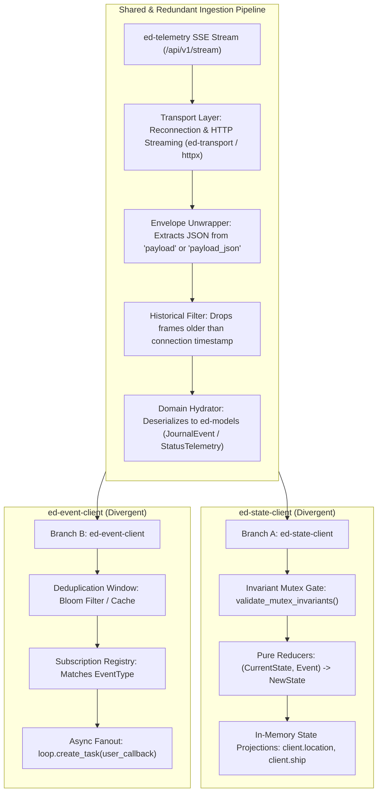

# Cross-Client Architectural Analysis: Shared, Divergent, and Redundant Processes in ed-state-client and ed-event-client

This document details the process commonalities, operational redundancies, and structural divergences between the two decoupled telemetry packages: `ed-state-client` and `ed-event-client`.

Beyond specifying upstream package dependencies (such as `ed-models` and `ed-transport`), this analysis examines the mechanical pipeline stages—specifically wire stream connection, payload unwrapping, domain model hydration, deduplication, and endpoint interaction with `ed-telemetry`.

---

## 1. Executive Process Comparison Matrix

| Pipeline Stage / Process | `ed-state-client` (Pull / Sampling) | `ed-event-client` (Push / Pub-Sub) | Relationship & Redundancy Level |
| :--- | :--- | :--- | :--- |
| **1. Upstream Wire Transport** | Connects to `ed-telemetry` SSE stream (`/api/v1/stream`) or WebSocket. | Connects to `ed-telemetry` SSE stream (`/api/v1/stream`) or WebSocket. | **100% Identical / Duplicated.** Both maintain identical HTTP client and reconnection logic. |
| **2. Initial State Seeding** | Calls `GET /api/v1/state` and `GET /api/v1/status` on startup. | Does not call snapshot endpoints; listens only to forward-moving events. | **Divergent.** Exclusive to `ed-state-client` to initialize RAM projections. |
| **3. Wire Envelope Unwrapping** | Extracts nested JSON string (`"payload"`, `"payload_json"`, or `"raw_payload"`). | Extracts nested JSON string (`"payload"`, `"payload_json"`, or `"raw_payload"`). | **100% Identical / Duplicated.** Unwraps topic envelopes and SSE frame wrappers. |
| **4. Domain Model Hydration** | Hydrates payloads into typed `ed-models` (`StatusTelemetry` and `JournalEvent`). | Hydrates payloads into typed `ed-models` (`StatusTelemetry` and `JournalEvent`). | **90% Shared.** Both require mapping JSON dictionaries to typed dataclasses. |
| **5. Historical Frame Filtering** | Drops frames where `timestamp < session_start` (unless replaying history). | Drops frames where `timestamp < session_start` to prevent replay triggers. | **100% Identical / Duplicated.** Prevents historic re-fires on reconnect. |
| **6. Event Deduplication** | Idempotent by nature (pure reducers overwrite state idempotently). | Requires deduplication window to prevent re-firing alert callbacks on reconnections. | **Divergent.** `ed-event-client` must track sliding cache of event UUIDs/hashes. |
| **7. Invariant Mutex Gating** | Mandatory gate: Drops physically contradictory frames (`validate_mutex_invariants`). | Optional / Minimal: Dispatches events as raw notifications without state gating. | **Divergent.** Invariants protect state stores, not transient event signals. |
| **8. State Engine Reduction** | Folds event into RAM projections (`LocationProjection`, `ShipProjection`). | None. Zero state memory allocated. | **Divergent.** Core engine of `ed-state-client`. |
| **9. Observer Callback Dispatch** | None. Pure passive in-memory queries. | Asynchronous `loop.create_task()` fanout to registered user handlers. | **Divergent.** Core engine of `ed-event-client`. |

---

## 2. Shared & Redundant Ingestion Mechanics

Both client libraries consume raw telemetry from the same upstream daemon (`ed-telemetry`). Consequently, both libraries perform identical operations across the first three stages of the pipeline:



### A. Redundant Wire Transport & SSE Streaming
* **The Process:** Both clients establish a long-lived HTTP GET request with `Accept: text/event-stream` against `GET /api/v1/stream` (or a persistent WebSocket transport).
* **Duplication:**
  * Reconnection backoff logic (`reconnect_delay_seconds = 2.0`).
  * Buffer line iteration (`response.aiter_lines()`).
  * Header preparation with API keys (`X-API-Key`, `Authorization: Bearer`).
* **Implication:** If an application runs both `ed-state-client` and `ed-event-client` independently on the same machine without a shared adapter, it opens **two simultaneous SSE streams** to `ed-telemetry`, doubling socket connections and deserialization CPU cycles.

### B. Redundant Envelope Unwrapping
* **The Process:** `ed-telemetry` wraps event packets into transport envelopes containing metadata (e.g. topic tags, sequence numbers, timestamps). The actual Frontier event is serialized as a JSON string inside `"payload"`, `"payload_json"`, or raw dictionary fields.
* **Duplication:** Both clients execute identical payload discovery loops:
  ```python
  if "raw_payload" in raw:
      data = json.loads(raw["raw_payload"])
  elif "payload" in raw:
      data = json.loads(raw["payload"])
  else:
      data = raw
  ```

### C. Redundant `ed-models` Domain Hydration
* **The Process:** Raw JSON dictionaries are parsed into strongly-typed `ed-models` instances:
  * Bitfield expansion: Converting 64-bit status integers (`Flags`, `Flags2`) into `StatusFlags` and `StatusFlags2`.
  * Status telemetry hydration: Unpacking pips `(SYS, ENG, WEP)`, fuel tanks, altitude, coordinates, and planet radius into `StatusTelemetry`.
  * Journal event hydration: Resolving event class schemas (e.g. `FSDJump`, `Docked`, `ScanOrganic`) via `parse_journal_event()`.
* **Duplication:** Both clients parse and validate identical payload structures.

---

## 3. Interaction with `ed-telemetry` Endpoints

The two clients diverge significantly in which HTTP REST endpoints they query:

### `ed-state-client` Endpoint Map
`ed-state-client` requires authoritative snapshots to seed state before the stream begins:
1. `GET /api/v1/state` *(Primary Seed):* Retrieves the consolidated state document from `ed-telemetry` (includes latest `game_status` and latest `latest_journal_event`).
2. `GET /api/v1/status` *(Fallback Seed):* Direct read of the latest un-gated cockpit status frame.
3. `GET /api/v1/stream` *(Continuous Updates):* Real-time SSE stream delivering forward-moving state changes.
4. `GET /api/v1/state/heartbeat` *(Health/Liveness):* Lightweight query returning state sequence counters and timestamps to detect stream stalls.

### `ed-event-client` Endpoint Map
`ed-event-client` has zero interest in historical state snapshots:
1. `GET /api/v1/stream` *(Exclusive Dependency):* Connects directly to the real-time event stream. Does not seed or query snapshot endpoints.

---

## 4. Key Divergences in Event Processing

Even when handling the exact same `ed-models` instance, the internal algorithms of each client are completely divergent:

### 1. Invariant Mutex Gating vs. Raw Passthrough
* **`ed-state-client`:** Must enforce physical plausibility. If a telemetry packet claims `DOCKED` and `SUPERCRUISE` simultaneously, the state engine **must drop or correct it** to prevent corrupted coordinates or impossible cockpit states.
* **`ed-event-client`:** Does not maintain state invariants. If Frontier emits contradictory raw events, observers listening to those individual event classes may still want to log or report them verbatim.

### 2. Selective Event Filtering vs. Comprehensive Event Fanout
* **`ed-state-client`:** Discards ~70% of incoming events. Ephemeral events (such as `Music`, `ReceiveText`, `FSSSignalDiscovered`, `SendText`) do not affect location, ship hardware, or session state and are ignored by reducers.
* **`ed-event-client`:** Must support all 285+ Frontier event classes. If a user registers `@client.on(ReceiveText)` or `@client.on(Music)`, the event client must deserialize and dispatch it immediately.

### 3. Idempotency vs. Deduplication Caching
* **`ed-state-client`:** State reducers are idempotent by design:
  $$\text{reduce}(\text{State}, \text{Event}_A) = \text{State}'$$
  Receiving `Event_A` twice in a row results in the exact same state projection without side effects.
* **`ed-event-client`:** Dispatching an event triggers external side effects (e.g., sending an SMS, posting to Discord, playing an audio siren). Receiving a duplicated frame on reconnect causes duplicate alerts. `ed-event-client` requires a sliding deduplication window (e.g., LRU cache of `(event_type, timestamp)` hashes).

---

## 5. Architectural Opportunities: Shared Foundation Package

Because stages 1 through 5 (Transport, Reconnection, Envelope Unwrapping, and Hydration) are 100% redundant, building both clients completely from scratch would result in duplicate code and divergent bug fixes.

### Recommendation: Core Ingestion Protocol / Base Engine
When implementing the repositories:
1. **Option A (Shared Ingestion Dependency):** Factor the transport and hydrator into a shared micro-layer (`ed-telemetry-transport` or `ed-stream-base`) that yields hydrated `(StatusTelemetry | JournalEvent)` streams. Both `ed-state-client` and `ed-event-client` consume this stream.
2. **Option B (Self-Contained Micro-Adapters):** If zero inter-repository dependency is desired, duplicate only the minimal transport/hydrator adapter (~150 lines of code) into each repository, keeping them fully standalone and decoupled.
