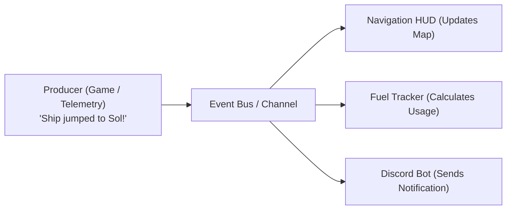
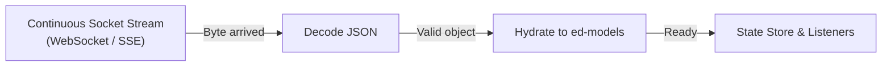
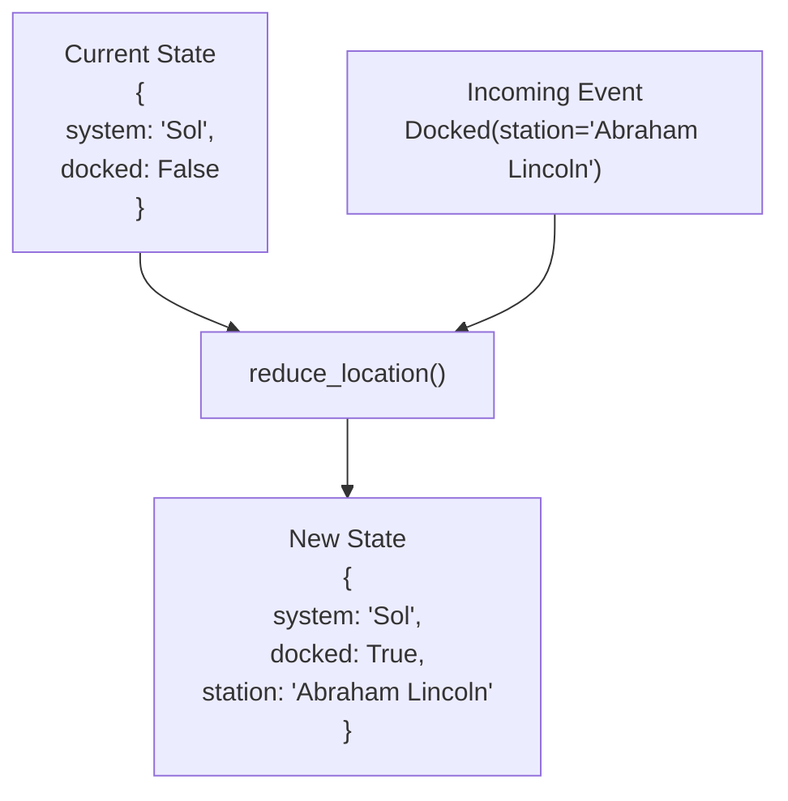
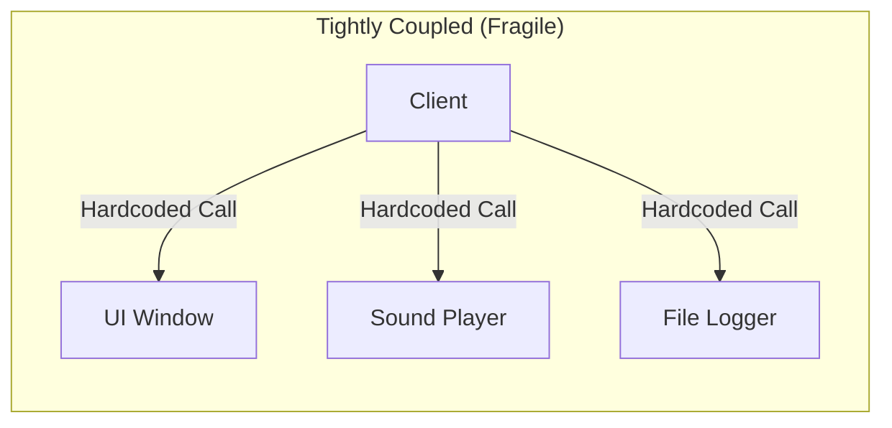
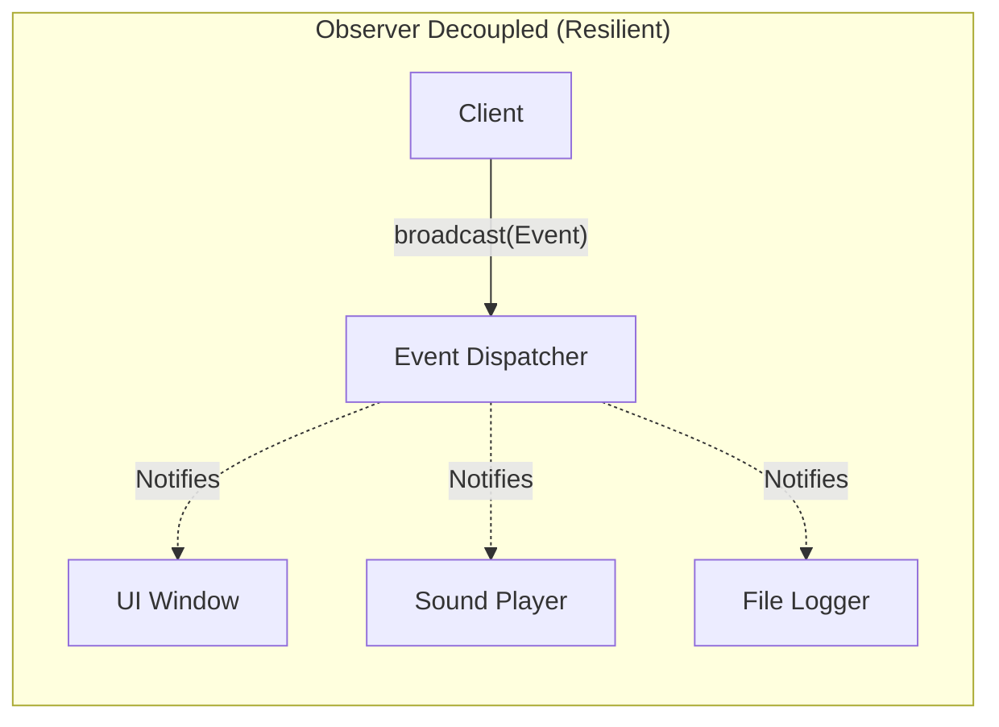
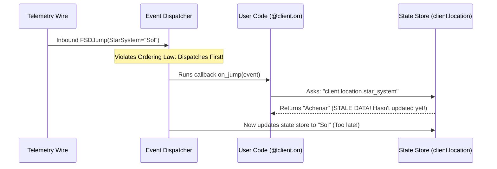
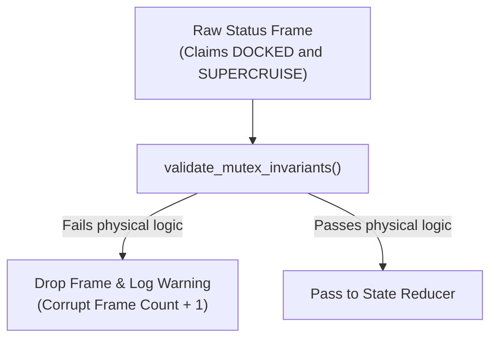
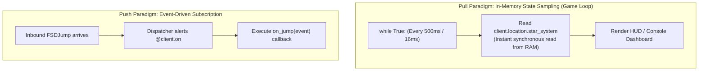
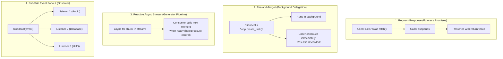
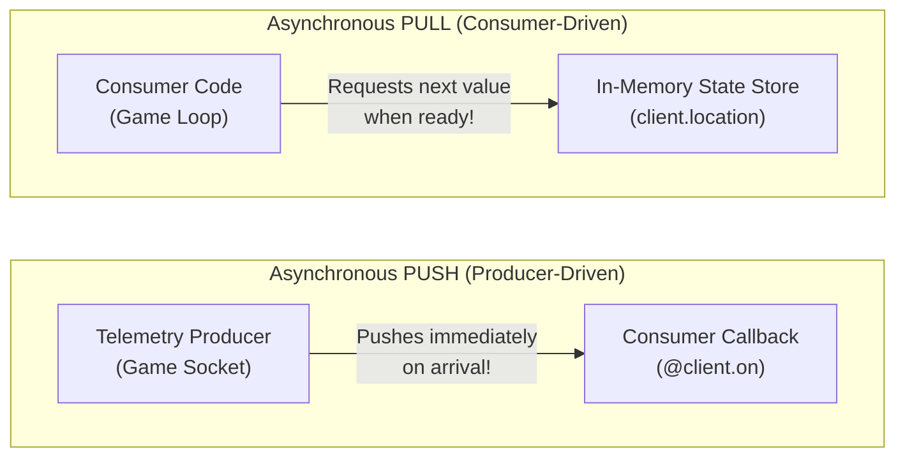

# Event-Driven Telemetry and State Fundamentals

This engineering primer breaks down the core concepts behind event-driven architecture, streaming data pipelines, state engines, and concurrency controls used within `ed-fleet-client`. Every section uses everyday analogies, diagrams, and direct code examples to illustrate how these ideas fit together.

---

## 1. Event-Driven Architecture (EDA) & Best Practices

### What Is It?
In traditional request-response programming, one part of your code directly tells another part what to do: *"Hey function B, run right now and give me an answer."* Both sides are tightly coupled together.

In an **Event-Driven Architecture (EDA)**, software components communicate by announcing that something significant has already happened in the outside world. This announcement is called an **Event**.

- **The Producer:** Announces: *"A jump happened: we arrived at system Sol."* The producer does not know or care who is listening.
- **The Consumer:** Listens for events it cares about and reacts independently (e.g., updating a map, playing an alert sound, logging to disk).



### Best Practices for EDA
1. **Events Represent the Past (Immutable Facts):** Name events using past tense or clear state transitions (`FSDJump`, `Docked`, `CargoEjected`). Never mutate an event packet after it has been announced.
2. **One-Way Unidirectional Data Flow:** Data travels in a clear line: *Input Event $\to$ State Update $\to$ Consumer Notification*. Never create circular loops where listening to an event fires the exact same event.
3. **Decouple Producers from Consumers:** The producer must never depend on the consumer's return value or crash if a consumer fails.

---

## 2. Reactive Stream Processing

### What Is It?
Instead of checking a file or database repeatedly (known as *polling*, which wastes CPU cycles), **reactive stream processing** sets up a continuous pipeline that sits dormant until new data flows into it.

When a byte or message arrives on a network socket, the pipeline "reacts" instantly, pushes the data through transformations, and delivers it to listeners.



### Everyday Analogy
Think of a conveyor belt at a factory. Workers (functions) do not walk back and forth to the warehouse asking if items exist. Instead, items arrive on the belt continuously. As soon as a box reaches a station, the worker performs their task immediately and the box rolls to the next station.

---

## 3. State Reduction

### What Is It?
An event tells you **what happened right now**, but it does not tell you **the whole story of where you are**.

A **State Reducer** is a clean, simple mathematical function that takes:
1. Your **Current State** (where you are right now).
2. The **Incoming Event** (the change that just happened).

It folds them together and returns a **Brand-New Current State**.

$$\text{Reducer}(\text{Current State}, \text{Event}) \to \text{New State}$$



### Direct Code Example

```python
from dataclasses import replace

# Pure Reducer Function: No side effects, no database calls, no network
def reduce_ship_fuel(current_fuel: float, event: dict) -> float:
    if event["event"] == "FuelScoop":
        # Return new state: current fuel + scooped amount
        return min(32.0, current_fuel + event["ScoopedAmount"])

    if event["event"] == "FSDJump":
        # Return new state: current fuel - jumped amount
        return max(0.0, current_fuel - event["FuelUsed"])

    # If event doesn't affect fuel, return current state unchanged
    return current_fuel
```

---

## 4. Asynchronous (Async)

### What Is It?
In standard **synchronous** code, your program does one thing at a time. If it downloads data from the internet or reads a large file from disk, execution stops and freezes until the operation finishes:

```python
# Synchronous (Blocks the entire thread)
data = read_from_server()  # The entire program is frozen waiting 500ms
print(data)
```

In **asynchronous** code, while waiting for a slow input/output operation (like a network packet arriving from `ed-telemetry`), the computer pauses that specific task and runs other work (such as rendering UI or processing cockpit coordinates):

```python
# Asynchronous (Does NOT block the thread)
async def fetch_telemetry():
    # Yield control back to the event loop while waiting for the network
    packet = await stream.read_packet()
    return packet
```

---

## 5. Event Dispatch

### What Is It?
**Event Dispatch** is the post office of your application. When an event is ready, the dispatcher looks up all registered listeners and hands each one a copy of the event.

```python
class SimpleDispatcher:
    def __init__(self):
        self._listeners = {}

    def register(self, event_type, callback):
        self._listeners.setdefault(event_type, []).append(callback)

    def dispatch(self, event):
        # Look up callbacks interested in this event type
        callbacks = self._listeners.get(type(event), [])
        for cb in callbacks:
            cb(event)  # Hand event to listener
```

---

## 6. The State Store Is the Foundation

### What Is a State Store?
A **State Store** is the single, authoritative in-memory snapshot of your entire application's reality. In `ed-fleet-client`, this is `TelemetryStateEngine` containing `ClientStateProjection` (`client.location`, `client.ship`, `client.session`).

### Why Is It the Foundation?
Without a state store, every UI component or script would have to listen to dozens of raw events and calculate everything from scratch:
- A navigation widget would have to listen to `FSDJump`, `CarrierJump`, `Location`, `ApproachBody`, and `SupercruiseExit`, and remember previous variables across hours of gameplay.
- If a new widget loads 20 minutes into a flight, it would have **zero data** until the next hyperspace jump happens.

With a State Store:
- The state store continuously aggregates all events in the background.
- Any part of the application can query `client.location.star_system` at any millisecond and immediately receive the current, accurate truth.

---

## 7. Observer Decoupling

### What Is It and Why Does It Matter?
**Observer Decoupling** means the component broadcasting data and the components receiving data have **zero direct knowledge of each other**.



If the Sound Player crashes or changes its function parameters, `Client` breaks.



In the decoupled model:
- `Client` only knows how to talk to `Dispatcher`.
- Listeners can be added, removed, paused, or replaced at runtime without changing a single line of client engine code.

---

## 8. The Ordering Law: State Engine Must Project State At or Before Event Dispatch

### The Law Stated
> **An application's state engine must project state at or before event dispatch.**

### Why This Law Exists: The Stale State Trap
Imagine you jump to the star system `Sol`. An event arrives from the game: `FSDJump(StarSystem="Sol")`.

Now imagine an architecture that violates this law by firing external event listeners **before** updating its state store:



Because the event was dispatched before the reducer updated the state store, the user's code asked `client.location.star_system` and received the **previous system (`Achenar`)**, causing logic errors, false alarms, or UI desynchronization.

### The Correct Implementation
`ed-fleet-client` strictly enforces the Ordering Law:

```python
def _handle_raw_event(self, raw: dict[str, Any]) -> None:
    # 1. REDUCE FIRST: Update state store synchronously
    _state, event = self._stream_use_case.process_raw_event(raw)

    # 2. DISPATCH SECOND: Now listeners see the fresh, updated state
    if event is not None:
        self._dispatch_use_case.dispatch(event)
```

Now, when any listener runs `@client.on(FSDJump)`, querying `client.location.star_system` is guaranteed to return `Sol`.

---

## 9. Reentrancy, Race Conditions, and Non-Deterministic Invocation

### A. What Is a Race Condition?
A **Race Condition** occurs when the correctness of a program depends on the relative timing or execution order of uncontrolled events:
- Process A reads bank balance: `$100`.
- Process B reads bank balance: `$100`.
- Process A deposits `$50` $\to$ sets balance to `$150`.
- Process B withdraws `$20` $\to$ overwrites balance to `$80` (clobbering A's deposit!).

The final result changes depending on which process finished first.

### B. What Is Non-Deterministic Invocation Order?
When multiple callbacks register to an event bus:
```python
@client.on(FSDJump)
def listener_one(event): ...

@client.on(FSDJump)
def listener_two(event): ...
```
The event bus provides **non-deterministic ordering**: you must never write code assuming `listener_one` will always finish before `listener_two` starts. If `listener_two` depends on something `listener_one` did, a race condition will occur.

### C. What Is Reentrancy?
**Reentrancy** occurs when a function execution is interrupted midway by a second call to the exact same function before the first execution has completed.

For example:
1. `reduce_state()` begins updating the ship hull.
2. In the middle of execution, a callback triggers another telemetry update.
3. `reduce_state()` is invoked a second time on the same thread before the first one finished.
4. If variables were half-written, state becomes corrupted.

Pure functional reducers (`current -> replace(current)`) prevent reentrancy bugs because they never mutate global shared memory directly.

---

## 10. Thread Safety & Invariant Gates

### A. Thread Safety: Protecting Shared Memory
In a modern client, network packets arrive on background I/O threads, while your application or UI reads state on the main thread.

If Thread 1 is writing coordinates `(10.0, 20.0, 30.0)` into memory at the exact same microsecond Thread 2 is reading them, Thread 2 could read half-written memory (e.g. `(10.0, 0.0, 0.0)`).

**Thread Safety** means protecting shared state with locks (`threading.RLock`) so only one thread can read or write at a time:

```python
class ThreadSafeState:
    def __init__(self):
        self._lock = threading.RLock()
        self._state = LocationProjection()

    def get_state(self):
        with self._lock:  # Locks out writers while reading
            return self._state

    def update_state(self, new_state):
        with self._lock:  # Locks out readers while writing
            self._state = new_state
```

### B. Invariant Gates: The Bouncers of the State Machine
An **Invariant** is a fundamental business rule that must **always be true**, no matter what input arrives.

Real-world telemetry feeds can be noisy, corrupted, or report out-of-order data during game crashes. An **Invariant Gate** acts as a validation checkpoint that drops or corrects impossible physical claims before they contaminate state.

In `ed-fleet-client`, [`validate_mutex_invariants()`](file:///home/michael/src/github.com/mnaatjes/ed-fleet-client/src/ed_fleet_client/core/domain/state/engine.py#L23-L56) enforces physical flight regimes:
1. **Regime Mutual Exclusion:** A ship cannot be simultaneously `DOCKED` and in `SUPERCRUISE`.
2. **Hardware Mutual Exclusion:** A ship cannot be in `SUPERCRUISE` with `LANDING_GEAR_DOWN` or `CARGO_SCOOP_DEPLOYED`.



By placing invariant gates at the boundary before reduction, `client.location` and `client.ship` remain 100% reliable, physically consistent, and clean of telemetry glitches.

---

## 11. State Consumption Patterns: Push vs. Pull (The Game Loop)

Once state is safely folded into memory by reducers, how do consumer applications read it? There are two primary paradigms:



### Pattern Names and Terminology

Depending on your engineering discipline, continuously reading state in a loop goes by several formal names:

1. **The Game Loop / Render Tick Pattern (Gaming & Simulation):**
   In cockpit simulators and games, user interfaces redraw on a fixed frame budget (e.g., 60 FPS = every 16.6ms, or 2 Hz = every 500ms). Rather than waiting for events, the loop ticks forward, samples `client.location` and `client.ship` directly from memory, and paints the screen:
   ```python
   while running:
       draw_hud(
           system=client.location.star_system,
           fuel=client.ship.telemetry.fuel_main if client.ship.telemetry else 0.0,
       )
       await asyncio.sleep(0.016)  # 60 FPS tick
   ```

2. **In-Memory State Sampling / Polling Loop (Control Planes & Systems):**
   Repeatedly inspecting an in-memory variable on a timer is called **State Polling** or **Sampling**.
   - **Crucial Distinction:** Unlike *network polling* (which spam-requests an HTTP server over Wi-Fi and wastes bandwidth), **in-memory sampling** reads local RAM that has already been hydrated in the background. It executes in nanoseconds with virtually zero CPU overhead.

3. **Immediate-Mode State Consumption (UI Architecture):**
   In modern immediate-mode UI frameworks (like Dear ImGui, Unity, and Flutter), widgets do not retain their own copies of text or state. Instead, they re-query the authoritative state store on every render pass.

4. **CQRS Projection Sampling (Software Architecture):**
   Under Command Query Responsibility Segregation (CQRS):
   - The background telemetry stream and reducers represent the **Write Model** (ingesting events and folding them into memory).
   - `client.location`, `client.ship`, and `client.session` represent the **Read Model** (materialized state projections).
   - The consumer's while loop represents the **Query Execution** sampling the read model.

### Choosing Between Loops and Event Listeners

| Application Need | Recommended Pattern | Code Recipe |
| :--- | :--- | :--- |
| **HUDs, GUIs, Overlays, Web Dashboards** | **Game Loop / State Sampling** | `while True: print(client.location.star_system); await asyncio.sleep(0.5)` |
| **Alerts, Sound Effects, Discord Bots** | **Event Listener (`@client.on`)** | `@client.on(FSDJump)` $\to$ `play_sound("jump.wav")` |
| **Sequential Procedural Scripts** | **One-Shot Awaiter (`wait_for`)** | `await client.wait_for(FSDJump)` |

---

## 12. Asynchronous Design Patterns: Taxonomies, Divergence, and Push vs. Pull

Asynchronous systems are not one-size-fits-all. Different operational requirements demand distinct async patterns depending on **who controls execution timing** and **whether a return value is expected**.

### The 4 Canonical Asynchronous Patterns



#### 1. Request-Response / Future-Promise Pattern
- **Definition:** The caller initiates a task, suspends its own execution, and awaits fulfillment of a Promise/Future containing a return value.
- **When to Use:** When the caller strictly needs the result of a remote or deferred calculation before proceeding.
- **Example in `ed-fleet-client`:**
  ```python
  snapshot = await client.get_snapshot("status", "/api/v1/status")
  ```

#### 2. Fire-and-Forget Pattern (`loop.create_task`)
- **Definition:** The caller schedules an asynchronous coroutine on the event loop and immediately returns without awaiting completion.
- **When to Use:** When the operation is purely for side effects (logging, analytics, sounds) and must **never** block or slow down the originating caller or ingestion pipeline.
- **Example in `ed-fleet-client`:**
  ```python
  # TelemetryEventDispatcher alerting a user listener without delaying the stream:
  loop.create_task(user_listener(event))
  ```

#### 3. Reactive Async Stream / Generator Pattern (`async for`)
- **Definition:** An unbounded sequence of asynchronous data elements delivered over time through an `AsyncIterator`.
- **When to Use:** Ingesting real-time network sockets, WebSockets, or Server-Sent Events (SSE) where packets arrive continuously over hours or days.
- **Example in `ed-fleet-client`:**
  ```python
  async for raw_json_packet in websocket_transport:
      process_telemetry(raw_json_packet)
  ```

#### 4. Publish / Subscribe (Pub/Sub) Fanout Pattern
- **Definition:** A single event is broadcast across a registry of decoupled observers, where each observer receives a copy independently.
- **When to Use:** When multiple independent subsystems need to react to the exact same game event without knowing about each other.
- **Example in `ed-fleet-client`:**
  ```python
  @client.on(FSDJump)
  def on_jump(event: FSDJump): ...
  ```

---

### The Fundamental Divide: Asynchronous Push vs. Asynchronous Pull

The single most important architectural axis in asynchronous communication is **who initiates data movement**:



#### Asynchronous Push (Producer-Driven)
* **Mechanics:** The producer decides **when** execution happens. When the outside world produces data, your code is immediately invoked via a callback or event handler.
* **Characteristics:** Lowest possible latency (near 0ms reaction time).
* **Risks:** **Buffer Overflow / Overload.** If the producer pushes 10,000 events/second but the consumer can only process 100 events/second, memory will balloon unless backpressure or fire-and-forget is applied.
* **Usage:** Instant alerts, audio cues, critical spatial hazard triggers (e.g., proximity warnings).

#### Asynchronous Pull (Consumer-Driven)
* **Mechanics:** The consumer decides **when** execution happens. The consumer asks for data only when it is idle, ready to render, or on a scheduled clock tick.
* **Characteristics:** Immune to consumer overload because the consumer controls its own pacing.
* **Risks:** Potential polling latency (e.g. if you poll every 500ms, you might see an event up to 500ms after it occurred).
* **Usage:** UI render loops, GUI dashboards, periodic health checks, batch aggregation.

---

### Pattern Divergence & Selection Matrix

| Pattern | Flow Direction | Execution Timing | Expected Result | Primary Danger |
| :--- | :--- | :--- | :--- | :--- |
| **Request-Response** | Pull (Bidirectional) | Synchronous to caller | Exact return value | Deadlock or slow network timeouts |
| **Fire-and-Forget** | Push (Unidirectional) | Concurrently in background | None (Ignored) | Unhandled errors silently discarded |
| **Async Stream (`async for`)** | Pull (Element-by-Element) | Sequential per element | Stream elements | Producer backlog if consumption is slow |
| **Pub/Sub Observer** | Push (Broadcasting) | Event-driven on arrival | None (Side effects) | Non-deterministic ordering across listeners |
| **State Store Sampling** | Pull (Synchronous Read) | Controlled by consumer tick | Instant snapshot | Local variable staleness if saved to variable |
