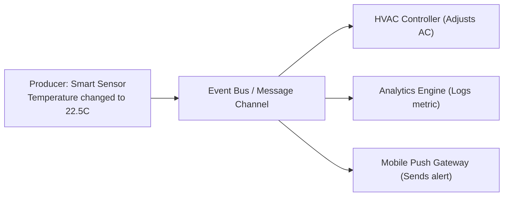
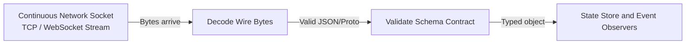
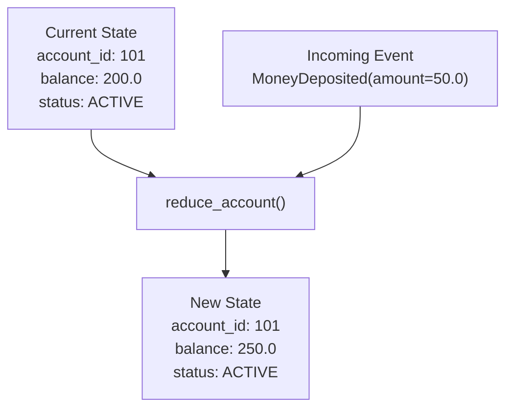
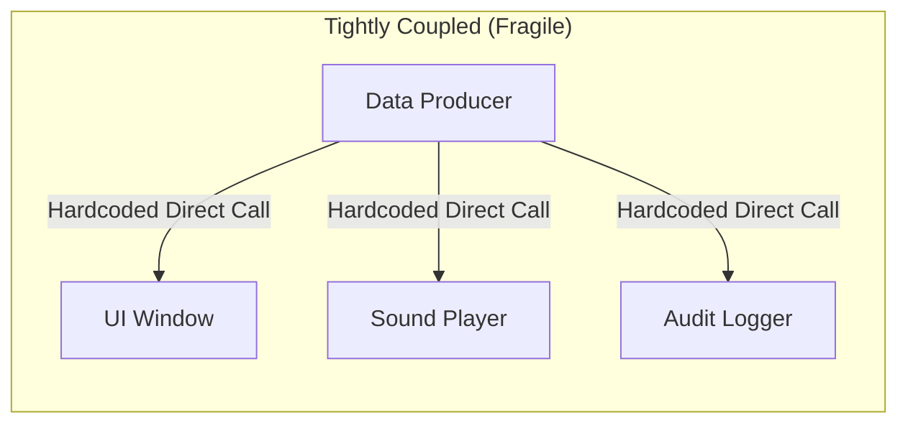
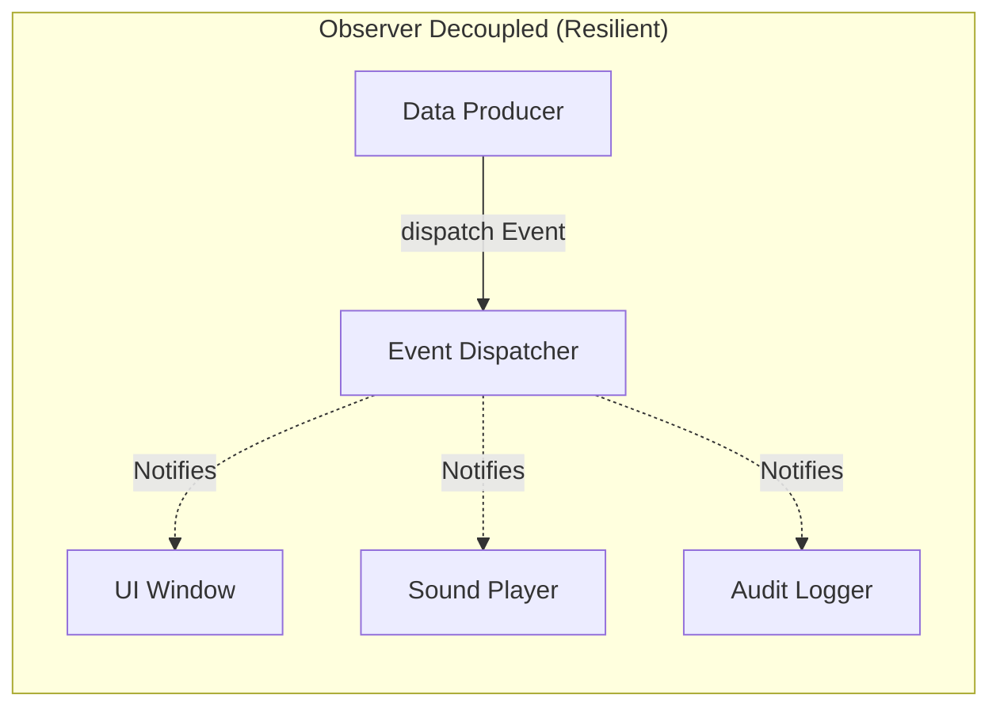
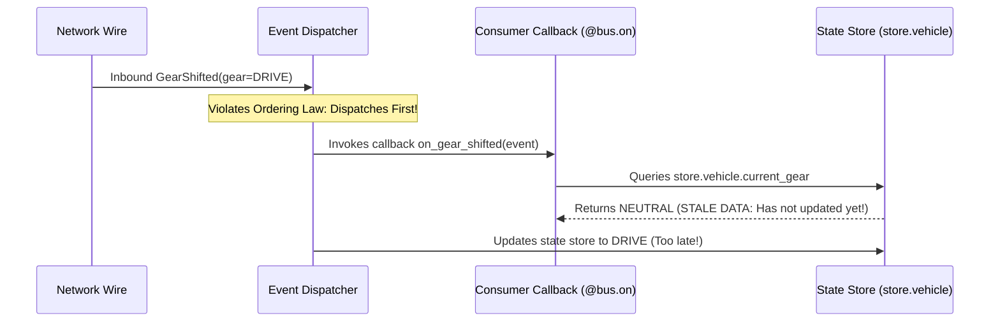
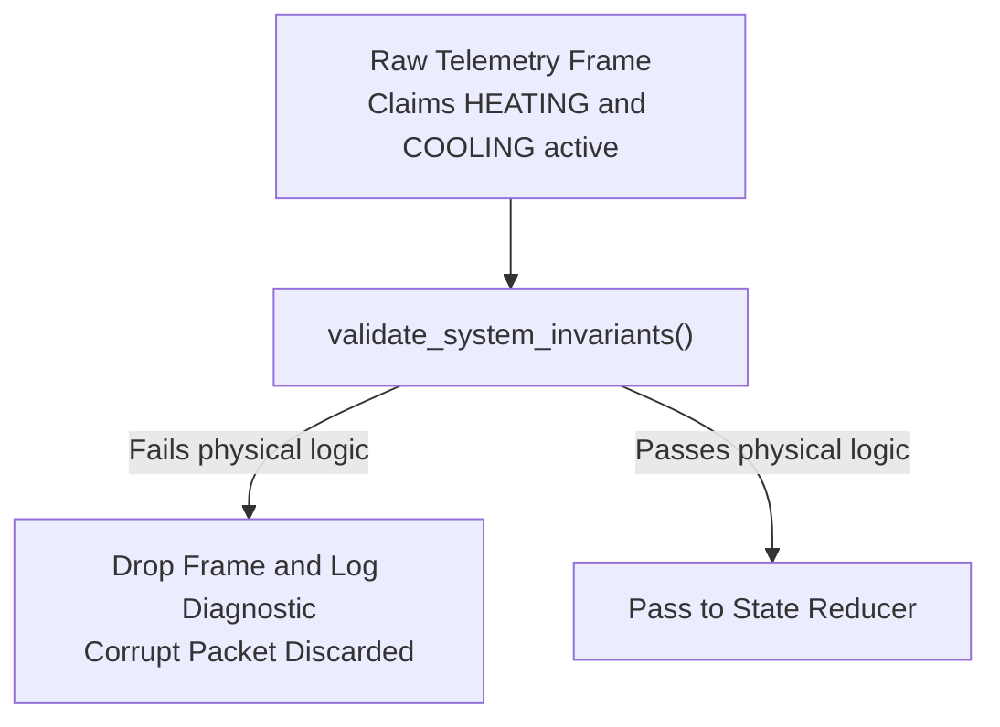
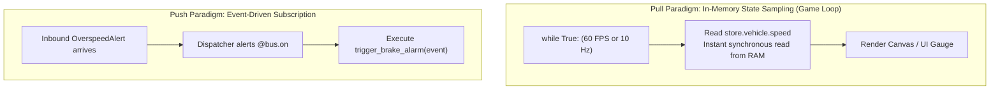
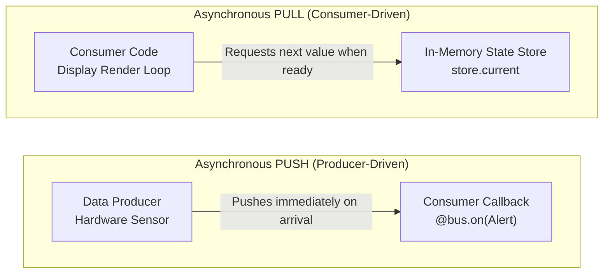

# Event-Driven Telemetry and State Fundamentals

This engineering primer establishes universal software engineering best practices for building robust reactive systems, stream processing pipelines, and state projection engines. To ensure clear conceptual mastery, all examples throughout this guide use domain-agnostic scenarios (such as smart thermostat telemetry, bank transaction streams, and autonomous vehicle tracking).

---

## 1. Event-Driven Architecture (EDA) & Best Practices

### What Is It?
In traditional request-response programming, one component directly commands another: *"Run function X right now and return a result."* Both sides are tightly coupled.

In an **Event-Driven Architecture (EDA)**, software components communicate by announcing that an immutable state change has already occurred. This announcement is called an **Event**.

- **The Producer:** Broadcasts an occurrence (e.g., *"Temperature changed to 22.5°C"* or *"Account 101 deposited $500"*). The producer has zero knowledge of who, if anyone, is listening.
- **The Consumer:** Subscribes to events it cares about and reacts independently (e.g., updating a dashboard, writing an audit log, or sending an SMS notification).



### Best Practices for EDA
1. **Events Represent the Past (Immutable Facts):** Name events using past tense verbs (`TemperatureSampled`, `OrderPlaced`, `AccountDebited`). Once created, event payloads must be strictly frozen and immutable.
2. **One-Way Unidirectional Data Flow:** Information moves strictly forward: $\text{Raw Event} \to \text{State Reduction} \to \text{Consumer Notification}$. Never build cyclical paths where reacting to an event triggers the exact same event.
3. **Decouple Producers from Consumers:** The producer must never depend on the consumer's return value, and a consumer failure must never crash the producer.

---

## 2. Reactive Stream Processing

### What Is It?
Instead of querying a database or file periodically (known as **polling**, which wastes CPU cycles and adds artificial latency), **reactive stream processing** sets up an asynchronous pipeline that sleeps until data physically arrives.

When a byte or frame appears on an active network socket or message broker, the pipeline awakens instantly, pushes the payload through parsing and transformation stages, and delivers it to downstream sinks.



### Everyday Analogy
Think of an industrial conveyor belt. Sorting workers do not repeatedly walk to the warehouse asking if new inventory has arrived. Items travel continuously down the belt; as soon as a box passes a station, the worker applies their transform immediately, and the box glides to the next stage.

---

## 3. State Reduction

### What Is It?
An event describes **what just happened**, but it does not represent **the complete current state of the world**.
* An event says: *"Deposit of $50 occurred."*
* It does not tell you: *"What is my current bank account balance?"*

A **State Reducer** is a pure mathematical function that computes the next state by combining:
1. The **Current State** (where the system was immediately before).
2. The **Incoming Event** (the change that just arrived).

$$\text{Reducer}(\text{Current State}, \text{Event}) \to \text{New State}$$



### Direct Code Example

```python
from dataclasses import dataclass, replace

@dataclass(frozen=True)
class AccountState:
    account_id: str
    balance: float
    is_frozen: bool

# Pure Reducer Function: No I/O, no network calls, no side effects
def reduce_account(current: AccountState, event: dict) -> AccountState:
    event_type = event.get("type")

    if event_type == "MoneyDeposited":
        return replace(current, balance=current.balance + event["amount"])

    if event_type == "MoneyWithdrawn":
        return replace(current, balance=max(0.0, current.balance - event["amount"]))

    if event_type == "AccountFrozen":
        return replace(current, is_frozen=True)

    # If the event does not alter this projection, return current state unchanged
    return current
```

---

## 4. Asynchronous (Async) Non-Blocking I/O

### What Is It?
In standard **synchronous** programming, operations execute sequentially. If your application reads from a slow network socket or queries a remote database, thread execution completely halts:

```python
# Synchronous (Blocks the thread)
data = socket.recv(4096)  # The CPU freezes waiting 200ms for data over the wire
render_dashboard(data)
```

In **asynchronous** programming, while waiting for external I/O (such as incoming sensor packets), the runtime yields control back to an event loop. The thread stays busy servicing other operations (like handling user input or repainting a UI):

```python
# Asynchronous (Non-blocking)
async def read_telemetry(stream):
    # Suspends execution and yields control until bytes physically arrive
    packet = await stream.read_packet()
    return packet
```

---

## 5. Event Dispatch

### What Is It?
**Event Dispatch** is the internal routing exchange of an application. When a valid event is parsed, the dispatcher matches the event type against its registry of subscribed listeners and passes the event payload to each one.

```python
class EventDispatcher:
    def __init__(self):
        self._registry = {}

    def subscribe(self, event_type, callback):
        self._registry.setdefault(event_type, []).append(callback)

    def dispatch(self, event):
        handlers = self._registry.get(type(event), [])
        for handler in handlers:
            handler(event)
```

---

## 6. The State Store Is the Foundation

### What Is a State Store?
A **State Store** is the single, authoritative, in-memory representation of an application's current state.

### Why Is It Essential?
Without a state store, every UI component, service, or script would be forced to listen to raw event streams from the moment the system launched:
* A dashboard widget loaded 2 hours into operation would possess **zero knowledge** of current system status until the next periodic event happens to arrive.
* Components would duplicate complex reconstruction logic across the entire codebase.

With a centralized State Store:
* Pure reducers continuously fold incoming events into an immutable state tree in memory.
* Any consumer can inspect `store.current` at any nanosecond and instantly retrieve verified, ambient truth.

---

## 7. Observer Decoupling

### Why Does It Matter?
**Observer Decoupling** guarantees that the component producing data and the components consuming data have **zero direct dependencies on each other**.



In a coupled model, if `Sound Player` throws an unhandled exception or alters its function signature, `Data Producer` crashes.



In the decoupled model:
- The data producer interacts strictly with the dispatcher.
- Listeners can be attached, removed, paused, or tested in total isolation without touching producer code.

---

## 8. The Ordering Law: State Engine Must Project State At or Before Event Dispatch

### The Law Stated
> **An application's state engine must project state at or before event dispatch.**

### Why This Law Exists: The Stale State Trap
Consider an autonomous vehicle telemetry system. The vehicle transitions gear from `NEUTRAL` to `DRIVE`. An event arrives: `GearShifted(gear="DRIVE")`.

Consider an engine that violates this law by triggering observer callbacks **before** updating its state store:



Because the event was dispatched before the reducer updated the state store, user code querying `store.vehicle.current_gear` received the **old gear (`NEUTRAL`)**, causing false alarms, illegal command validation, or desynchronized UI dashboards.

### The Correct Implementation
The ingestion engine must enforce sequential order internally:

```python
def handle_incoming_frame(raw_frame: dict) -> None:
    # 1. REDUCE FIRST: Compute and apply new state synchronously
    event = parse_event(raw_frame)
    state_store.apply(event)

    # 2. DISPATCH SECOND: Observers now see the updated truth in the store
    event_dispatcher.dispatch(event)
```

---

## 9. Reentrancy, Race Conditions, and Non-Deterministic Invocation

### A. What Is a Race Condition?
A **Race Condition** occurs when program correctness depends on uncontrolled timing or execution order:
1. Thread A reads account balance: `$100`.
2. Thread B reads account balance: `$100`.
3. Thread A deposits `$50` $\to$ sets balance to `$150`.
4. Thread B withdraws `$20` $\to$ overwrites balance to `$80` (clobbering A's deposit!).

The final value varies depending on thread scheduling.

### B. What Is Non-Deterministic Invocation Order?
When multiple observers register for the same event type:
```python
@dispatcher.on(TemperatureAlert)
def write_audit_log(event): ...

@dispatcher.on(TemperatureAlert)
def trigger_cooling_fan(event): ...
```
Unless explicitly documented by the framework, **never assume which listener executes first**. Observers must remain entirely independent of one another.

### C. What Is Reentrancy?
**Reentrancy** occurs when a function execution is interrupted midway by a second invocation of that exact same function before the first call finishes.
1. `reduce_state()` begins writing updated fields to a mutable global dictionary.
2. An observer callback triggered mid-function invokes `reduce_state()` again.
3. The internal state dictionary becomes partially updated or corrupt.

**Remediation:** Pure functional reducers returning brand-new immutable objects (`replace(current, ...)`) are inherently reentrant and immune to mid-cycle state corruption.

---

## 10. Thread Safety & Invariant Gates

### A. Thread Safety: Protecting Shared Memory
In reactive applications, network packets arrive on background I/O threads, while rendering engines or user scripts read state on the main thread.

If Thread 1 updates coordinates `(x, y, z)` at the exact microsecond Thread 2 reads them, Thread 2 risks reading tearing or half-written values. Shared mutable state must be synchronized using locks or rendered atomic via immutable reference swapping:

```python
import threading

class ThreadSafeStateStore:
    def __init__(self):
        self._lock = threading.RLock()
        self._state = InitialState()

    def get_state(self):
        with self._lock:
            return self._state

    def update_state(self, new_state):
        with self._lock:
            self._state = new_state
```

### B. Invariant Gates: The Bouncers of the State Machine
An **Invariant** is a foundational domain rule that must **always be true**, regardless of input data.

Real-world telemetry feeds can be noisy, duplicate packets, or report physically impossible states due to network corruption. An **Invariant Gate** acts as an entry filter that rejects or normalizes invalid claims before they contaminate state.

* Example in HVAC Telemetry: A system cannot report `HEATING_ACTIVE` and `COOLING_ACTIVE` simultaneously.
* Example in Banking: An account cannot have `status="CLOSED"` while maintaining an active uncollected loan.



---

## 11. State Consumption Patterns: Push vs. Pull (The Game Loop)

Once state is folded into memory, how do consumer applications read it? There are two primary paradigms:



### Pattern Names and Terminology

1. **The Game Loop / Render Tick Pattern (Gaming & Simulation):**
   Fixed frame budget loops (e.g., 60 FPS = every 16.6ms). Rather than waiting on events, the loop ticks forward, samples in-memory state variables, and updates the display:
   ```python
   while running:
       draw_gauge(speed=store.telemetry.speed, battery=store.telemetry.battery)
       await asyncio.sleep(0.016)
   ```

2. **In-Memory State Sampling / Polling Loop (Control Planes & Systems):**
   Repeatedly reading an in-memory variable on a timer is called **State Sampling**.
   - *Crucial Distinction:* Unlike *network polling* (which spams remote servers over HTTP and wastes bandwidth), *in-memory sampling* reads local RAM that has already been hydrated in the background. It executes in nanoseconds with zero network overhead.

3. **Immediate-Mode State Consumption (UI Architecture):**
   In immediate-mode frameworks (Dear ImGui, Flutter, Unity), widgets do not retain local state copies. They query the state store directly on each frame pass.

4. **CQRS Projection Sampling (Software Architecture):**
   Under Command Query Responsibility Segregation (CQRS):
   - The streaming pipeline represents the **Write Model** (ingesting events and folding them into state).
   - `store.current` represents the **Read Model** (materialized projections).
   - Consumer sampling represents the **Query Execution**.

### Choosing Between Loops and Event Listeners

| Application Need | Recommended Pattern | Code Recipe |
| :--- | :--- | :--- |
| **Gauges, Dashboards, Cockpit HUDs** | **Game Loop / State Sampling** | `while True: print(store.telemetry.speed); await asyncio.sleep(0.1)` |
| **Audible Sirens, Discord Bots, SMS Alerts** | **Event Listener (`@bus.on`)** | `@bus.on(OverspeedAlert)` $\to$ `play_alarm()` |
| **Sequential Scripts / Workflows** | **One-Shot Awaiter (`wait_for`)** | `await bus.wait_for(EngineStarted)` |

---

## 12. Asynchronous Design Patterns: Taxonomies, Divergence, and Push vs. Pull

Different operational requirements demand distinct asynchronous patterns depending on **who controls timing** and **whether a return value is expected**.

### The 4 Canonical Asynchronous Patterns


#### 1. Request-Response / Future-Promise Pattern
- **Definition:** The caller schedules an operation, suspends its own execution, and awaits fulfillment of a Promise/Future containing a return value.
- **When to Use:** When the caller strictly requires data before proceeding (e.g., fetching a configuration snapshot on startup).

#### 2. Fire-and-Forget Pattern (`loop.create_task`)
- **Definition:** The caller schedules a task on the event loop and immediately returns without awaiting completion.
- **When to Use:** Pure side-effects (e.g., telemetry audit logging, analytics fanout) where a slow subscriber must **never** block or slow down the originating ingestion stream.

#### 3. Reactive Async Stream / Generator Pattern (`async for`)
- **Definition:** An unbounded sequence of asynchronous data elements delivered over time through an `AsyncIterator`.
- **When to Use:** Ingesting real-time network sockets, WebSockets, or SSE streams where items arrive continuously over hours or days.

#### 4. Publish / Subscribe (Pub/Sub) Fanout Pattern
- **Definition:** An event is broadcast across a registry of decoupled observers, where each observer receives a copy independently.
- **When to Use:** When multiple independent subsystems need to react to the exact same occurrence without knowing about each other.

---

### The Fundamental Divide: Asynchronous Push vs. Asynchronous Pull

The single most important architectural axis in asynchronous communication is **who initiates data movement**:



#### Asynchronous Push (Producer-Driven)
* **Mechanics:** The producer decides **when** execution happens. When the outside world produces data, your code is immediately invoked via a callback or event handler.
* **Characteristics:** Lowest possible latency (near 0ms reaction time).
* **Risks:** **Buffer Overflow / Overload.** If the producer pushes 10,000 events/second but the consumer can only process 100 events/second, memory will balloon unless backpressure or fire-and-forget is applied.
* **Usage:** Instant alerts, audio cues, critical spatial hazard triggers (e.g., proximity warnings).

#### Asynchronous Pull (Consumer-Driven)
* **Mechanics:** The consumer decides **when** execution happens. The consumer asks for data only when it is idle, ready to render, or on a scheduled clock tick.
* **Characteristics:** Immune to consumer overload because the consumer controls its own pacing.
* **Risks:** Potential polling latency (e.g. if you poll every 500ms, you might see an event up to 500ms after it occurred).
* **Usage:** UI render loops, GUI dashboards, periodic health checks, batch aggregation.

---

### Pattern Divergence & Selection Matrix

| Pattern | Flow Direction | Execution Timing | Expected Result | Primary Danger |
| :--- | :--- | :--- | :--- | :--- |
| **Request-Response** | Pull (Bidirectional) | Synchronous to caller | Exact return value | Deadlock or slow network timeouts |
| **Fire-and-Forget** | Push (Unidirectional) | Concurrently in background | None (Ignored) | Unhandled errors silently discarded |
| **Async Stream (`async for`)** | Pull (Element-by-Element) | Sequential per element | Stream elements | Producer backlog if consumption is slow |
| **Pub/Sub Observer** | Push (Broadcasting) | Event-driven on arrival | None (Side effects) | Non-deterministic ordering across listeners |
| **State Store Sampling** | Pull (Synchronous Read) | Controlled by consumer tick | Instant snapshot | Local variable staleness if saved to variable |
