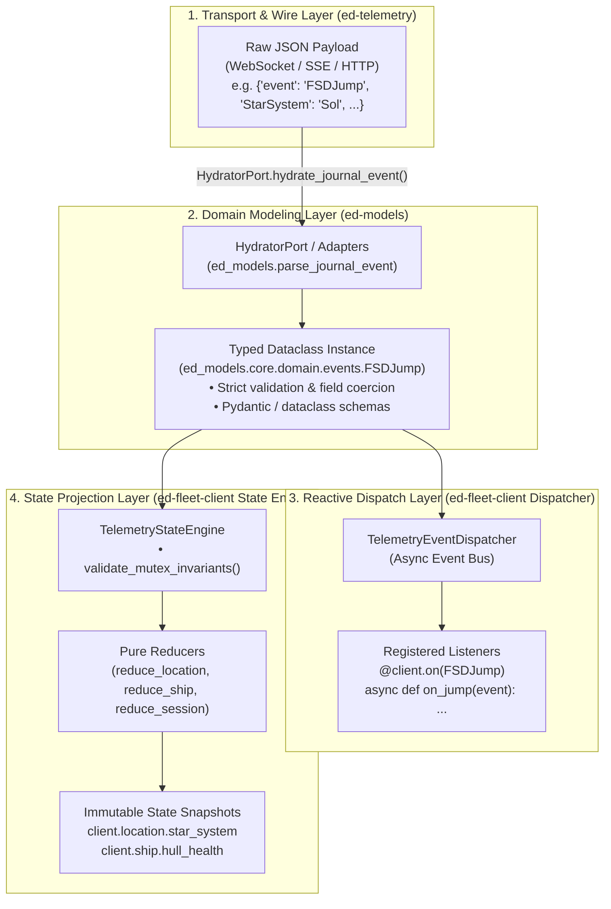

# Telemetry Pipeline & State Hierarchy: Wire to Reducer

This document explains the structural hierarchy and dataflow that connects raw *Elite Dangerous* telemetry wire packets to strongly-typed event models, reactive async subscriber loops, and materialized state engine projections within `ed-fleet-client`.

---

## 1. Architectural Pipeline Overview

The client library decouples telemetry transport from consumer state through a unidirectional 4-stage pipeline:



---

## 2. Stage Breakdown and Responsibilities

### Stage 1: `ed-telemetry` Event-Payload (The Wire)
- **Role:** Wire transport and raw serialization format.
- **Representation:** Untyped dictionary (`dict[str, Any]`) delivered over WebSocket or SSE connections.
- **Semantics:** Emitted by the `ed-telemetry` daemon reading directly from Frontier Developments journal log files (`Journal.*.log`) and memory-mapped status files (`Status.json`). Field names reflect Frontier casing (`StarSystem`, `SystemAddress`, `StarPos`).

### Stage 2: `ed-models` (The Schema & Contract Layer)
- **Role:** Domain contract enforcement, schema validation, and type coercion.
- **Representation:** Strongly-typed immutable dataclasses (e.g. `ed_models.core.domain.events.FSDJump`).
- **Semantics:** Handled by `HydratorPort` via `parse_journal_event()` and `StatusTelemetry`. Guarantees that downstream client code operates on validated Python types (integers, floats, tuples, datetimes) rather than untrusted strings or nulls.

### Stage 3: Async Event (The Reactive Push Bus)
- **Role:** Real-time push notification for arbitrary event subscribers.
- **Representation:** Asynchronous callback invocation via `TelemetryEventDispatcher`.
- **Semantics:** When a typed `ed-models` instance is received, `ExecuteEventDispatchUseCase` fans out the event concurrently to all matching `@client.on(EventType)` listeners.
- **Scope:** Exhaustively covers **all 566 properties** across all 287 Frontier events, including the 520 ephemeral, event-only data points cataloged in `docs/reference/event_streaming_catalog.md`.

### Stage 4: Reducer (The Materialized State Engine)
- **Role:** Deterministic, stateful folding into consolidated in-memory projections.
- **Representation:** Immutable projection dataclasses (`LocationProjection`, `ShipProjection`, `SessionProjection`).
- **Semantics:** Handled by `TelemetryStateEngine` running pure reducer functions:

  $$(P_{\text{current}}, E) \to P_{\text{next}}$$

  Before folding, frames are screened by `validate_mutex_invariants()` to prevent contradictory states (e.g., claiming to be simultaneously docked and in supercruise).
- **Scope:** Materializes the **46 core navigation, session, and ship properties** cataloged in `docs/reference/state_projections_and_reducers.md`.

---

## 3. Comparison Matrix

| Stage | Entity / Class | Representation | Primary Consumer Access |
| :--- | :--- | :--- | :--- |
| **1. Wire** | `ed-telemetry` payload | Raw JSON string / `dict` | Telemetry transport adapters |
| **2. Contract** | `ed-models` | `@dataclass` (e.g. `FSDJump`) | Hydration ports & adapters |
| **3. Stream** | Async Event | Event Dispatcher push | `@client.on(EventType)` reactive listeners |
| **4. State** | Reducer State | `*Projection` dataclass | `client.location`, `client.ship`, `client.session` |

---

## 4. Code Example: Push vs. Pull Telemetry Consumption

```python
from ed_fleet_client import EliteDangerousClient
from ed_models.core.domain.events import ApproachBody, EjectCargo

async with EliteDangerousClient() as client:
    # 1. State Layer (Pull / Synchronous Read):
    # Materialized by reducers from previous events (FSDJump, Location, ApproachBody)
    current_system = client.location.star_system
    fuel_level = client.ship.telemetry.fuel_main if client.ship.telemetry else 0.0
    print(f"Current System: {current_system}, Fuel: {fuel_level}t")

    # 2. Event Layer (Push / Reactive Callback):
    # Triggers in real time when Frontier emits the event packet
    @client.on(EjectCargo)
    def on_cargo_ejected(event: EjectCargo) -> None:
        # Event-only property (unmapped from long-lived state)
        if event.Abandoned:
            print(f"Jettisoned abandoned cargo: {event.Type}")
```
