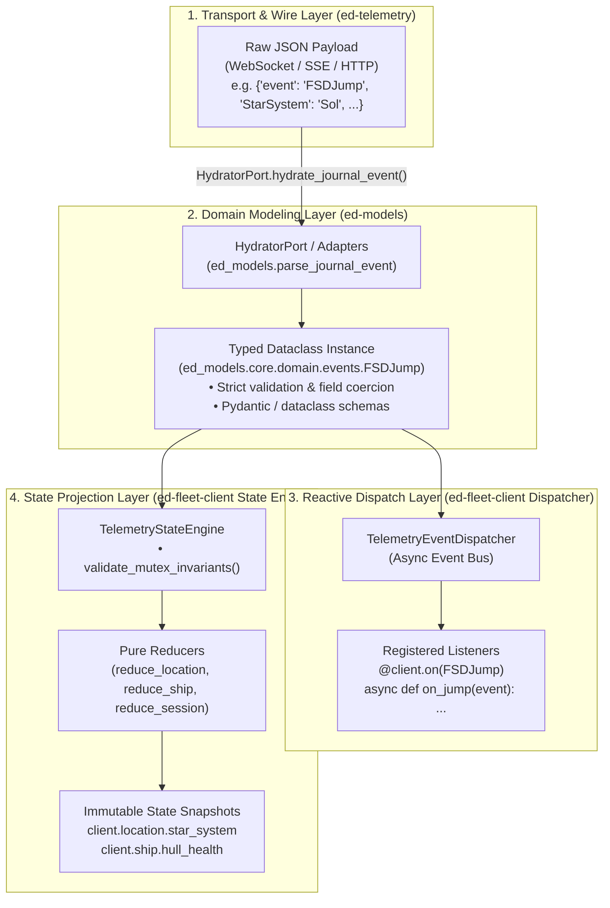
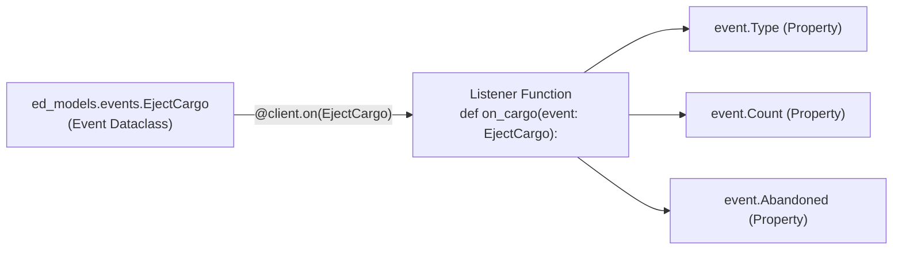
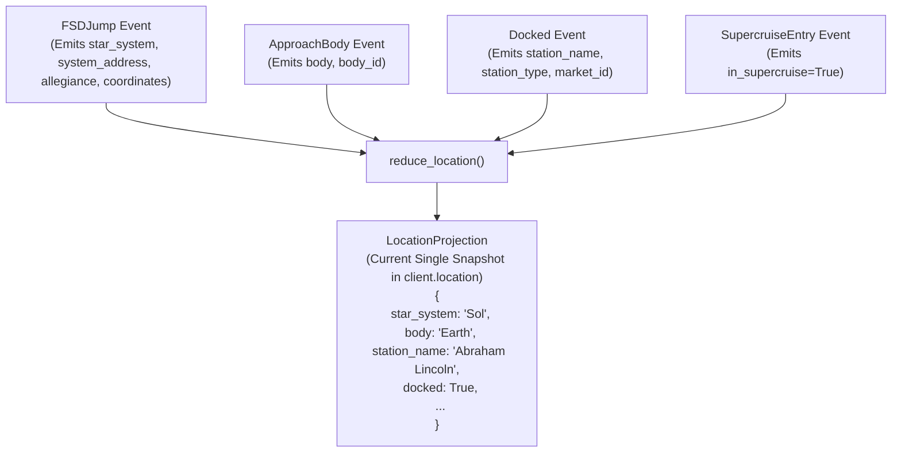
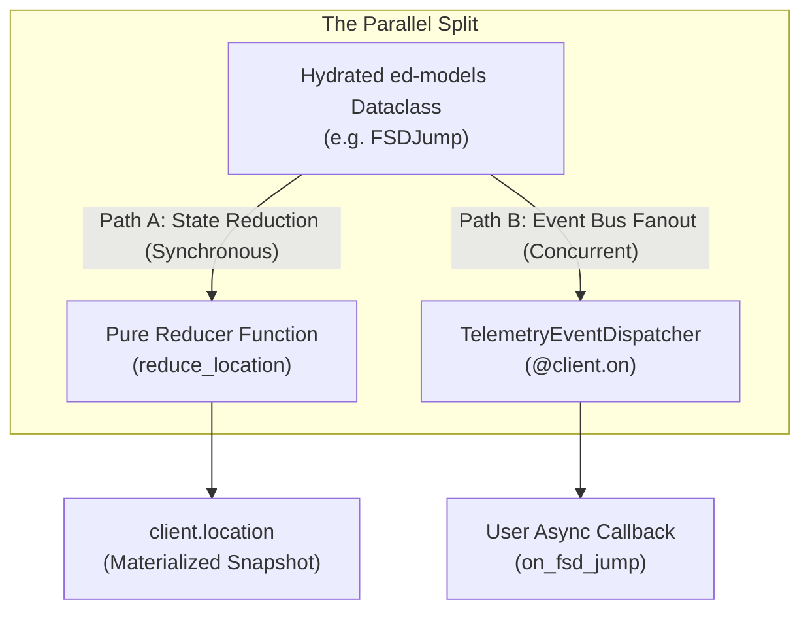

# Telemetry Pipeline & State Hierarchy: Wire to Reducer

This document explains the structural hierarchy and dataflow that connects raw *Elite Dangerous* telemetry wire packets to strongly-typed event models, reactive async subscriber loops, and materialized state engine projections within `ed-fleet-client`.

---

## 1. Architectural Pipeline Overview

The client library decouples telemetry transport from consumer state through a unidirectional 4-stage pipeline:



---

## 2. Stage Breakdown and Responsibilities

### Stage 1: `ed-telemetry` Event-Payload (The Wire)
- **Role:** Wire transport and raw serialization format.
- **Representation:** Untyped dictionary (`dict[str, Any]`) delivered over WebSocket or SSE connections.
- **Semantics:** Emitted by the `ed-telemetry` daemon reading directly from Frontier Developments journal log files (`Journal.*.log`) and memory-mapped status files (`Status.json`). Field names reflect Frontier casing (`StarSystem`, `SystemAddress`, `StarPos`).

### Stage 2: `ed-models` (The Schema & Contract Layer)
- **Role:** Domain contract enforcement, schema validation, and type coercion.
- **Representation:** Strongly-typed immutable dataclasses (e.g. `ed_models.core.domain.events.FSDJump`).
- **Semantics:** Handled by `HydratorPort` via `parse_journal_event()` and `StatusTelemetry`. Guarantees that downstream client code operates on validated Python types (integers, floats, tuples, datetimes) rather than untrusted strings or nulls.

### Stage 3: Async Event (The Reactive Push Bus)
- **Role:** Real-time push notification for arbitrary event subscribers.
- **Representation:** Asynchronous callback invocation via `TelemetryEventDispatcher`.
- **Semantics:** When a typed `ed-models` instance is received, `ExecuteEventDispatchUseCase` fans out the event concurrently to all matching `@client.on(EventType)` listeners.
- **Scope:** Exhaustively covers **all 566 properties** across all 287 Frontier events, including the 520 ephemeral, event-only data points cataloged in `docs/reference/event_streaming_catalog.md`.

### Stage 4: Reducer (The Materialized State Engine)
- **Role:** Deterministic, stateful folding into consolidated in-memory projections.
- **Representation:** Immutable projection dataclasses (`LocationProjection`, `ShipProjection`, `SessionProjection`).
- **Semantics:** Handled by `TelemetryStateEngine` running pure reducer functions:

  $$(P_{\text{current}}, E) \to P_{\text{next}}$$

  Before folding, frames are screened by `validate_mutex_invariants()` to prevent contradictory states (e.g., claiming to be simultaneously docked and in supercruise).
- **Scope:** Materializes the **46 core navigation, session, and ship properties** cataloged in `docs/reference/state_projections_and_reducers.md`.

---

## 3. Comparison Matrix

| Stage | Entity / Class | Representation | Primary Consumer Access |
| :--- | :--- | :--- | :--- |
| **1. Wire** | `ed-telemetry` payload | Raw JSON string / `dict` | Telemetry transport adapters |
| **2. Contract** | `ed-models` | `@dataclass` (e.g. `FSDJump`) | Hydration ports & adapters |
| **3. Stream** | Async Event | Event Dispatcher push | `@client.on(EventType)` reactive listeners |
| **4. State** | Reducer State | `*Projection` dataclass | `client.location`, `client.ship`, `client.session` |

---

## 4. Code Example: Push vs. Pull Telemetry Consumption

```python
from ed_fleet_client import EliteDangerousClient
from ed_models.core.domain.events import ApproachBody, EjectCargo

async with EliteDangerousClient() as client:
    # 1. State Layer (Pull / Synchronous Read):
    # Materialized by reducers from previous events (FSDJump, Location, ApproachBody)
    current_system = client.location.star_system
    fuel_level = client.ship.telemetry.fuel_main if client.ship.telemetry else 0.0
    print(f"Current System: {current_system}, Fuel: {fuel_level}t")

    # 2. Event Layer (Push / Reactive Callback):
    # Triggers in real time when Frontier emits the event packet
    @client.on(EjectCargo)
    def on_cargo_ejected(event: EjectCargo) -> None:
        # Event-only property (unmapped from long-lived state)
        if event.Abandoned:
            print(f"Jettisoned abandoned cargo: {event.Type}")
```

---

## 5. Dispatch Granularity vs. Property Granularity

A common architectural question is whether the async event bus dispatches at the individual property level (e.g., `@client.on("star_system")`) or at the dataclass event level.

The event bus operates with a **strict 1:1 mapping at the event dataclass level**, preserving Frontier transaction boundaries and avoiding dispatch overhead. Individual property granularity is resolved inside the callback or via state projections:



### Architectural Rationale
1. **Transaction Integrity:** Frontier telemetry arrives in atomic journal packets containing multiple related attributes (e.g., `EjectCargo` simultaneously reports cargo type, count, mission status, and abandoned state). Discarding the envelope to dispatch individual property scalars would destroy contextual coherence.
2. **Polymorphic Subscriptions:** The dispatcher matches Python classes, allowing applications to subscribe to specific events (`@client.on(FSDJump)`), broad journal categories (`@client.on(JournalEvent)`), or high-frequency telemetry frames (`@client.on(StatusTelemetry)`).
3. **Role of Property Mapping:** The generated reference catalogs (`canonical_property_map.md` and `event_streaming_catalog.md`) index data by property because developers typically approach telemetry with a question about a specific attribute (e.g., *"How do I track `hull_health`?"*). The catalog maps that property back to its enclosing event class (`Loadout`, `StatusTelemetry`) for subscription.

---

## 6. Temporal State Synthesis: How Reducers Merge Disparate Events

In *Elite Dangerous*, no individual event emits a complete picture of the vessel or commander. Instead, state is emitted piecemeal as flight transitions occur over time.

### Multi-Event Folding into Projections ($N:1$)

Pure reducers accumulate and fold discrete fields across multiple disparate event classes into a single unified projection dataclass:



- When `FSDJump` occurs, `reduce_location` updates `star_system` and spatial coordinates while resetting docked status.
- When `ApproachBody` follows minutes later, `reduce_location` updates `body` and `body_id`, retaining the previously recorded `star_system`.
- When `Docked` arrives at a space station, `reduce_location` sets `docked=True` and populates `station_name` without erasing prior astronomical data.

### Parallel Divergence: Reducer vs. Dispatcher

Reducers do **not** rely on `TelemetryEventDispatcher`. The event bus is **not** a prerequisite for state reduction. When an inbound packet arrives, the dataflow immediately branches into two independent paths:



### Architectural Distinctions

| Dimension | Reducer Layer (`client.state.*`) | Async Event Bus (`@client.on(...)`) |
| :--- | :--- | :--- |
| **Relationship to `ed-models`** | **Consumer / Fold Function:** Reads specific fields off diverse event models to update state. | **Direct Container / Matcher:** Dispatches the entire event model intact to registered callbacks. |
| **Relationship to Each Other** | **None.** Does not listen to, invoke, or depend on `@client.on(...)`. | **None.** Does not read from or depend on `client.state`. |
| **Cardinality to Events** | **$N:1$ (Many-to-One):** Dozens of distinct event classes merge into 1 projection. | **$1:1$ (One-to-One):** 1 `@client.on(EventClass)` matches 1 event class. |
| **Execution Timing** | Executes **first**, synchronously updating in-memory state. | Executes **second**, asynchronously invoking user callbacks. |
| **Data Scope** | 46 core navigation, session, and ship attributes. | All 566 properties across all 287 Frontier events. |
| **Failure Domain** | Isolated under thread-safe state engine locks. | User handler errors are caught and recorded as `HandlerFailure`. |
